<div align="center">

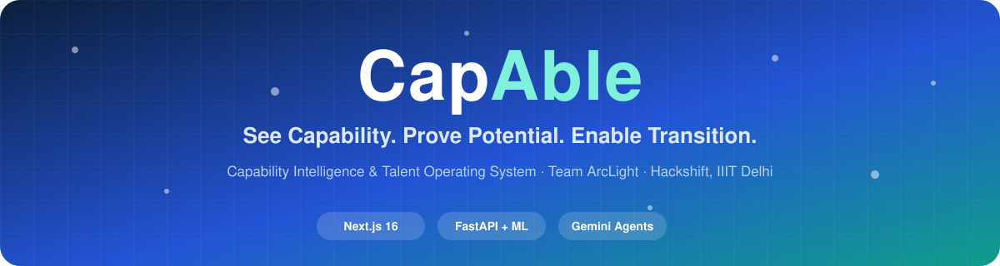

<a href="https://readme-typing-svg.demolab.com"></a>

<br>

[](https://capable-alpha.vercel.app)
[](https://www.youtube.com/watch?v=InX9qLdTvsY)
[](https://huggingface.co/Devengoyal/accesshire-mpnet-final)


# CapAble: Capability Intelligence & Talent Operating System

### Hiring on what people can *do*, not where they studied, what they were titled, or how long their résumé is.

**[Problem](#-the-problem) · [Solution](#-our-solution) · [Demo](#-demo) · [Impact](#-impact-at-a-glance) · [Twin](#-the-capability-twin) · [Features](#-feature-showcase) · [AI engine](#-the-ai-engine) · [Architecture](#-architecture) · [Status](#-honest-project-status) · [Run](#-run-it-locally) · [Roadmap](#-roadmap) · [Team](#-team-arclight)**


</div>

## 🔗 Quick links

<div align="center">

| | Resource | Link |
|:-:|:--|:--|
| 🚀 | **Live prototype** | [capable-alpha.vercel.app](https://capable-alpha.vercel.app) |
| 🎬 | **Demo video** | [youtube.com/watch?v=InX9qLdTvsY](https://www.youtube.com/watch?v=InX9qLdTvsY) |
| 💻 | **Frontend repository** | [Devengoyal885/Access-Hire](https://github.com/Devengoyal885/Access-Hire) *(copy in [`frontend/`](frontend/))* |
| 🧠 | **Machine learning repository** | [Devengoyal885/accesshireml](https://github.com/Devengoyal885/accesshireml) *(copy in [`ml-service/`](ml-service/))* |
| 🤗 | **Trained model** | [accesshire-mpnet-final](https://huggingface.co/Devengoyal/accesshire-mpnet-final) |
| 📦 | **Dataset** | [Google Drive](https://drive.google.com/drive/folders/17lZrwG7Z14cZZMHHAoW76IvVGWXqVab2) *(you may need to request access)* |
| 🖼️ | **Showcase page** | [`showcase/index.html`](showcase/index.html) |
| 📋 | **Feature audit** | [`docs/FEATURE_AUDIT.md`](docs/FEATURE_AUDIT.md) |

</div>

---

## 💥 The problem

> **Talent is not scarce. Capability is hidden.**

Static résumés, degree and employer-name filters, self-declared skills and career gaps push capable people out of the funnel. Employers cannot verify what a candidate can really do, and institutions cannot see the true skill picture of their own students.

<table>
<tr>
<td width="33%" valign="top">

### 😟 Candidate
- Strong work, weak pedigree → **filtered out**
- Career gaps read as **red flags**
- No clear path from *now* to *target role*

</td>
<td width="33%" valign="top">

### 🏢 Employer
- Keyword-stuffed PDFs, **no proof**
- Hiring on **brand names**, not skill
- **Bias** creeps into shortlists

</td>
<td width="33%" valign="top">

### 🏛️ Institution
- Placement data is **scattered and manual**
- NAAC / NIRF reporting is **painful**
- No view of **curriculum vs market gap**

</td>
</tr>
</table>

<p align="center"></p>

---

## 💡 Our solution

CapAble replaces the static résumé with a **living Capability Twin** and moves every person through a single loop.

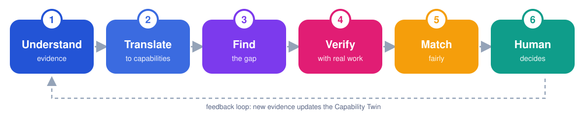

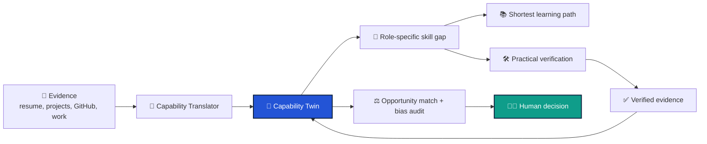

### Four pillars

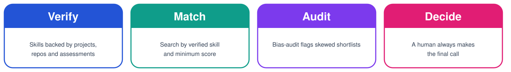

### Before vs after

<div align="center">

| | ❌ Traditional hiring | ✅ With CapAble |
|:--|:--|:--|
| **Unit of trust** | A résumé claim | A verified capability record |
| **Filter** | College, title, keywords | Verified skill and minimum score |
| **Career gaps** | Red flag | Evidence of what the person can do now |
| **Skill proof** | Self-declared | Projects, repos, assessments, with a confidence score |
| **Shortlist fairness** | Unchecked | Bias-audit agent flags skewed lists |
| **Final call** | Opaque | AI recommends, **a human decides** |

</div>

---

## 🎬 Demo

[](https://www.youtube.com/watch?v=InX9qLdTvsY)

<p align="center"><i>Click the image to watch the demo on YouTube, or try the <a href="https://capable-alpha.vercel.app">live prototype</a>.</i></p>

---

## 📊 Impact at a glance

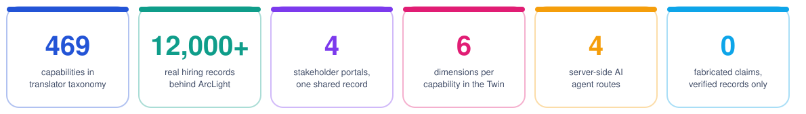

<div align="center">

| 🧩 Also in the platform | |
|:--|:--|
| **4** job sources aggregated and de-duplicated | **3** predictive models (salary, hike, seniority) |

</div>

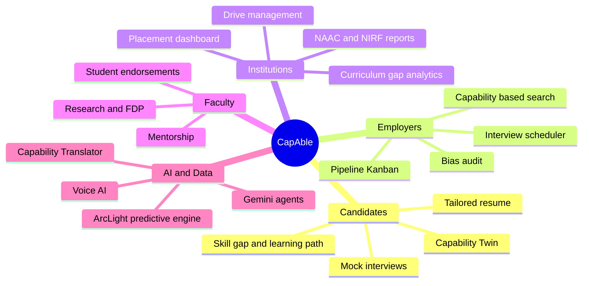

---

## 🧬 The Capability Twin

<table>
<tr>
<td width="55%" align="center">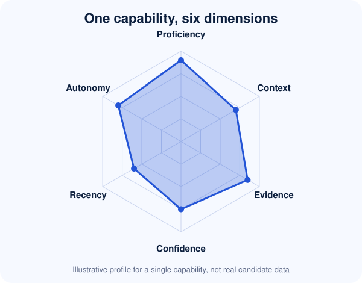</td>
<td width="45%" valign="middle">

| Dimension | Answers |
|:--|:--|
| 🎚️ **Proficiency** | How good is the person at it? |
| 🧩 **Context** | Where and how was it used? |
| 📎 **Evidence** | What proves it? |
| 🔒 **Confidence** | How sure are we? |
| ⏱️ **Recency** | How fresh is the skill? |
| 🦅 **Autonomy** | Can they do it independently? |

</td>
</tr>
</table>

<p align="center"></p>

New work becomes new evidence → the Twin updates → future matching improves.

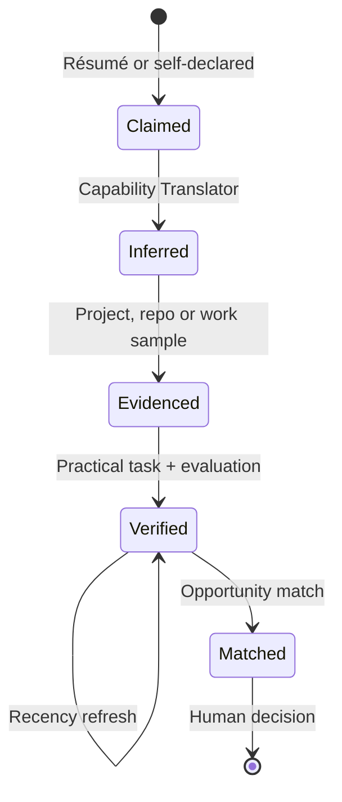

---

## 🌐 One platform, four stakeholders

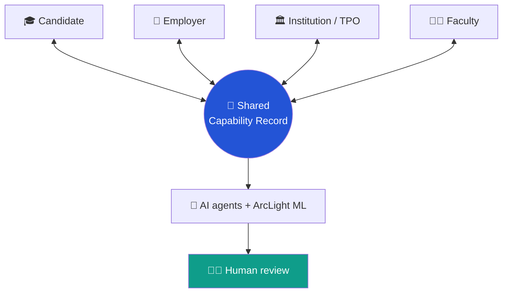

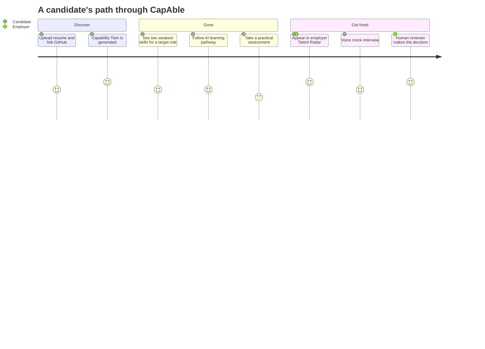

---

## ✨ Feature showcase

> Status legend: ✅ working in the deployed prototype · 🧪 prototype / partial · 🗺️ planned. See [Honest project status](#-honest-project-status).

### 🎓 Candidate

<div align="center">

| | Feature | What it does | Status |
|:-:|:--|:--|:-:|
| 🪪 | **3D holographic identity card** | Spring-tilt physics, specular glare, capability-confidence ring, verification watermark | ✅ |
| 📈 | **Capability matrix & readiness score** | Verified skills (0–100%) and a composite career-readiness score | ✅ |
| 🏅 | **Peer benchmarking** | College and branch percentile ranking | ✅ |
| 🔁 | **Skill gap → learn → opportunity loop** | Finds the two weakest skills with 1-click *Learn*, *Assess*, *Roles* | ✅ |
| 🧭 | **AI learning pathways** | Milestone-based curriculum from Gemini, linked to docs, videos and repos | ✅ |
| 📝 | **Resume Studio** | ATS score, job-tailored resume, **no-fabrication engine** limited to verified projects | ✅ |
| 🛣️ | **Career roadmap** | Role-transition simulation with exact missing requirements | ✅ |
| 🌍 | **Portfolio & public profile** | GitHub telemetry sync, shareable `/u/:username`, QR-linked certificates | ✅ |
| 🎙️ | **AI voice mock interview** | Speech-to-speech via Vapi + Gemini, with clarity, confidence and filler-word analytics | ✅ |
| 💻 | **Coding IDE, aptitude, case-study & GD arena** | Monaco editor, Piston/Judge0 runner, timed aptitude with history | 🧪 |
| ✉️ | **MailIQ outreach** | Personalised recruiter cold emails with subject-line optimisation | 🧪 |

</div>

### 🏢 Employer

<div align="center">

| | Feature | What it does | Status |
|:-:|:--|:--|:-:|
| 📡 | **Talent Radar** | Search by verified skill and minimum score (e.g. React ≥ 85%), not keywords | ✅ |
| ⚔️ | **Candidate comparison** | Side-by-side radar-chart comparison | 🧪 |
| 📌 | **Role posting & match matrix** | Post roles; auto-match against enrolled students | ✅ |
| 🗂️ | **Pipeline (ATS)** | Applied → Shortlisted → Round 1 → Technical → Offer → Hired | ✅ |
| 📅 | **Interview scheduler & offer letters** | Slot coordination, invites, offer-letter generation | ✅ |

</div>

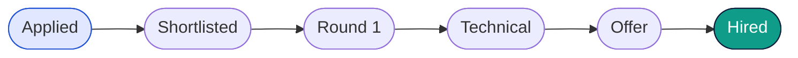

### 🏛️ Institution & Faculty

<div align="center">

| | Feature | What it does | Status |
|:-:|:--|:--|:-:|
| 📊 | **Placement dashboard** | Enrolled, placed, placement %, average and highest CTC | ✅ |
| 📥 | **Bulk CSV invite & skill-matrix export** | Onboard cohorts and export skill data | ✅ |
| 🏛️ | **NAAC / NIRF reporting** | Criterion 5 tables with print/PDF export | ✅ |
| 👨‍🏫 | **Faculty dashboard & endorsements** | Cohort progress and institutional skill endorsements | ✅ |
| 🚧 | **Drive management admin, multi-channel comms, curriculum-gap analytics** | Eligibility rules, broadcasts, syllabus insights | 🗺️ |

</div>

### ♿ Inclusion & accessibility

<div align="center">

| | Feature | What it does | Status |
|:-:|:--|:--|:-:|
| 🔤 | **Synapse UI** | One-tap OpenDyslexic typeface and high-contrast reading modes | ✅ |
| ⚖️ | **Bias-audit agent** | Flags skewed shortlists for human review | 🧪 |
| 🤝 | **Equity-nudge & job-fairness agents** | Proactive fairness checks across the funnel | 🗺️ |

</div>

---

## 🤖 The AI engine

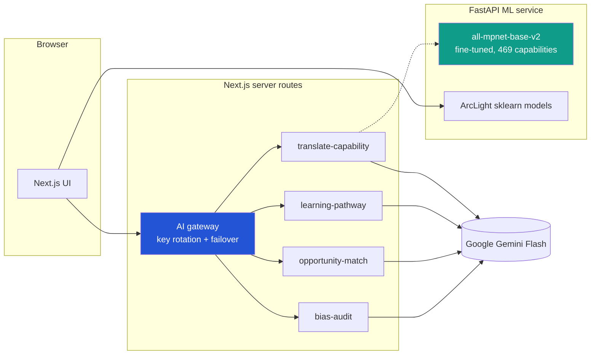

### 🧠 Capability Translator (ML service)
FastAPI service built on an `all-mpnet-base-v2` model fine-tuned on a **469-capability taxonomy**, with precomputed embeddings and an explainability breakdown for every inference.

<div align="center">

| Method | Path | Purpose |
|:-:|:--|:--|
| `GET` | `/` | Service info |
| `GET` | `/health` | Health check |
| `GET` | `/capabilities` | List known capabilities |
| `POST` | `/infer-capabilities` | Infer capabilities from free text (`text`, optional `top_k` 1–20, default 8) |

</div>

```bash
curl -X POST http://localhost:8000/infer-capabilities \
  -H "Content-Type: application/json" \
  -d '{"text": "Led a volunteer team and built a budgeting spreadsheet", "top_k": 5}'
```

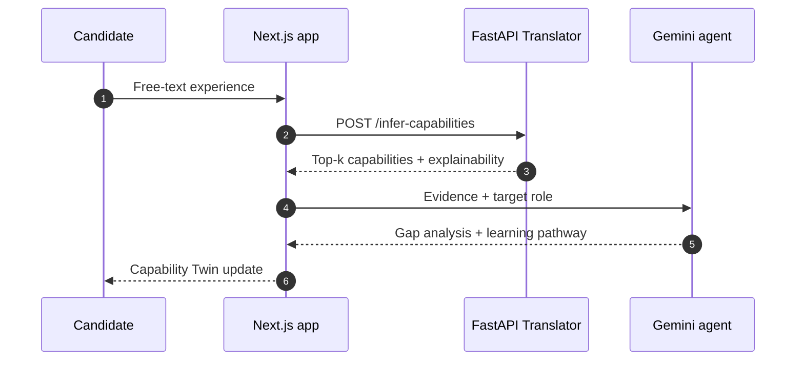

### 🎯 Gemini agent routes

<div align="center">

| Route | Role |
|:--|:--|
| `translate-capability` | Turns raw evidence into capabilities |
| `learning-pathway` | Builds a milestone-based learning plan |
| `opportunity-match` | Matches a Twin to roles, with an evidence trail |
| `bias-audit` | Flags skewed shortlists for human review |

</div>

All server-side, each match carrying an evidence trail.

### ⚡ ArcLight predictive engine
Scikit-learn re-implementation of enterprise SAS models over 12,000+ hiring records.

<div align="center">

| Model | Predicts |
|:--|:--|
| 💰 **High-salary model** | Probability of a ≥ 15 LPA offer, with skill-boost levers |
| 📈 **Salary-hike predictor** | Appraisal and role-switch increments |
| 🧗 **Senior success potential** | Leadership and complex-delivery readiness |

</div>

Plus market-intelligence endpoints for top roles, salary distribution, skill demand and hiring hubs.

### 🔑 AI gateway
Server-side proxy with key rotation and automatic failover on rate limits. Keys never reach the browser.

---

## 🛡️ Proctoring & integrity

<div align="center">

| Layer | Capability |
|:--|:--|
| 👁️ **Vision** | In-browser face detection via `@vladmandic/face-api`: multi-face, presence and gaze checks |
| 🔒 **Lockdown** | Fullscreen enforcement, tab-switch and window-blur counters, auto-termination at threshold |

</div>

---

## 🏗️ Architecture

<p align="center"></p>

Solid boxes exist in the repositories. Dashed boxes are planned.

<div align="center">

| Layer | Technology | Source |
|:--|:--|:--|
| 🖥️ Web app | Next.js 16.3.1, React 19, TypeScript, Tailwind CSS 4, Framer Motion, Recharts, Zustand, lucide-react | `Access-Hire/package.json` |
| 🔌 Server API routes | `translate-capability`, `learning-pathway`, `opportunity-match`, `bias-audit` | `Access-Hire/app/api/agents/` |
| 🧠 ML inference | FastAPI, sentence-transformers, PyTorch 2.3.1 (CPU), scikit-learn, pandas | `accesshireml/requirements.txt`, `Dockerfile` |
| ✨ Generative agents | Google Gemini Flash | `Access-Hire/lib/gemini.ts` |
| 🔐 Authentication | Supabase | `Access-Hire/.env.example` |
| ♿ Accessibility | Synapse context (OpenDyslexic, high contrast) | `Access-Hire/lib/synapse-context.tsx` |
| ☁️ Deployment | Frontend on Vercel; ML service ships with a Dockerfile | live prototype, `accesshireml/Dockerfile` |

</div>

The deployed prototype also uses Firestore, a Vapi voice interview and Firebase email triggers; check its own code for those.

---

## 📏 Honest project status

> We would rather be exact than impressive.

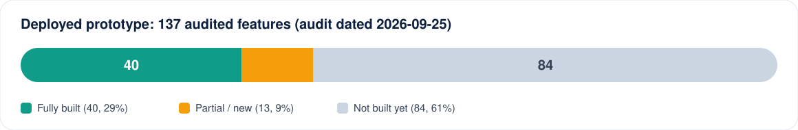

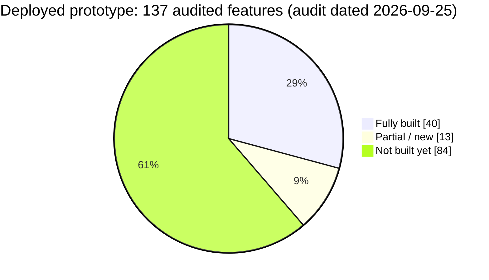

<p align="center"></p>

<div align="center">

| Area | Working today |
|:--|:--|
| 🎓 Candidate career | AI career-path mapping, skill-gap analysis, personalised learning paths, QR-linked certificates, public profile, portfolio with GitHub sync, resume tailoring, ATS score |
| 🎙️ Interview prep | AI voice mock interview, session history and statistics, filler-word counter |
| 🏛️ Institution | Placement dashboard, bulk CSV invite, NAAC/NIRF report, faculty dashboard, skill-matrix export |
| 🏢 Employer | Role posting, candidate pipeline, offer-letter generation, interview scheduling |
| ⚙️ Platform | Role-based security rules, in-app notifications, dark mode |

</div>

**Not built yet:** equity-nudge and job-fairness agents, automated bias-audit reports in the deployed app, auto-scored practical tasks, WCAG compliance, mobile app.

---

## ⚙️ Run it locally

<table>
<tr>
<td width="50%" valign="top">

### 🖥️ Frontend
Node.js 20+ and npm. Code is in [`frontend/`](frontend/).

```bash
cd frontend
npm install
cp .env.example .env.local
npm run dev   # http://localhost:3000
```

</td>
<td width="50%" valign="top">

### 🧠 ML service
Code is in [`ml-service/`](ml-service/).

```bash
cd ml-service
pip install -r requirements.txt
# or: docker build -t accesshire-ml .
uvicorn app.main:app --host 0.0.0.0 --port 8000
```

</td>
</tr>
</table>

<div align="center">

| Variable | Used for |
|:--|:--|
| `GOOGLE_GEMINI_API_KEY` | Server-side Gemini calls |
| `NEXT_PUBLIC_GEMINI_API_KEY` | Exposed to the browser. Avoid in production; use the server-side key |
| `NEXT_PUBLIC_SUPABASE_URL`, `NEXT_PUBLIC_SUPABASE_ANON_KEY` | Supabase authentication |
| `ACCESSHIRE_ML_API_URL` | URL of the running ML service |

</div>

Never commit real keys. Other scripts: `npm run build`, `npm run start`, `npm run lint`. The repository's `AGENTS.md` warns that Next.js 16 has breaking changes, so read `node_modules/next/dist/docs/` before framework-level changes.

---

## 🖼️ Gallery

These are illustrations, not screenshots. Add real screenshots in [`assets/screenshots/`](assets/screenshots/README.md).

<table>
  <tr>
    <td align="center"><br><sub>Learning and upskilling</sub></td>
    <td align="center"><br><sub>Institutions and placements</sub></td>
  </tr>
  <tr>
    <td align="center"><br><sub>Verified capability</sub></td>
    <td align="center"><br><sub>Workforce insight</sub></td>
  </tr>
</table>

---

## 🗺️ Roadmap

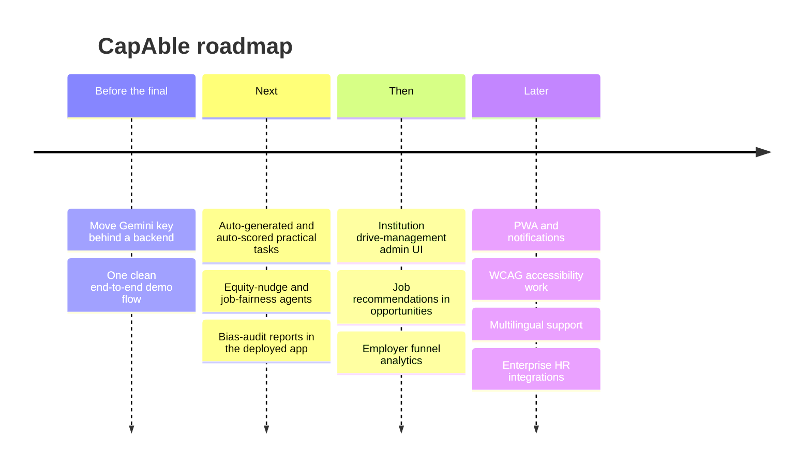

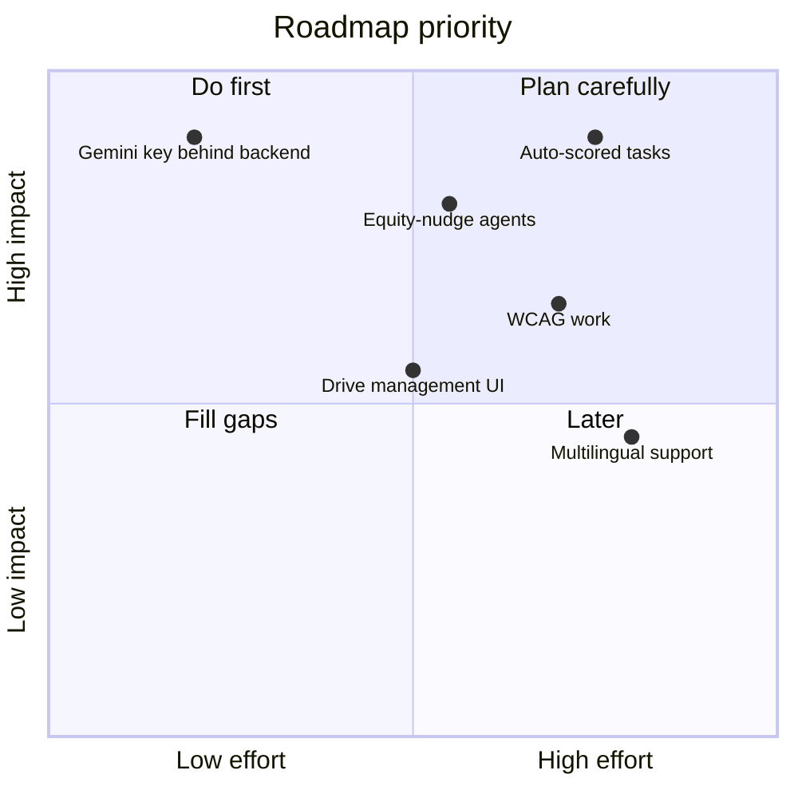

*Quadrant positions are the team's rough planning estimates.*

---

## ⚖️ Responsible AI & privacy

<div align="center">

| | Principle | In practice |
|:-:|:--|:--|
| 🧑‍⚖️ | **AI recommends, a human decides** | Match and bias-audit outputs are for human review |
| 🔎 | **Explainable by design** | Every capability carries evidence and an explanation |
| 🚫 | **No fabrication** | Resume generation is restricted to verified projects and capabilities |
| 🔐 | **Role-based security** | Rules protect data in the deployed prototype |
| 📝 | **No compliance claims** | Keep real personal data out of the demo; share datasets only with permission |

</div>

---

## 👥 Team ArcLight

<div align="center">

**Hackshift · IIIT Delhi**

<table>
<tr>
<td align="center" width="25%">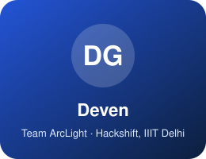<br><b>Deven</b><br><sub>Role: <code>YOUR ROLE</code></sub><br><a href="https://github.com/Devengoyal885"></a><br><a href="https://www.linkedin.com/in/YOUR-HANDLE"></a></td>
<td align="center" width="25%">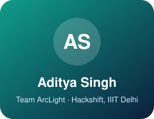<br><b>Aditya Singh</b><br><sub>Role: <code>YOUR ROLE</code></sub><br><a href="https://github.com/YOUR-GITHUB"></a><br><a href="https://www.linkedin.com/in/YOUR-HANDLE"></a></td>
<td align="center" width="25%">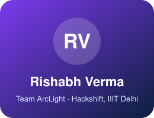<br><b>Rishabh Verma</b><br><sub>Role: <code>YOUR ROLE</code></sub><br><a href="https://github.com/YOUR-GITHUB"></a><br><a href="https://www.linkedin.com/in/YOUR-HANDLE"></a></td>
<td align="center" width="25%">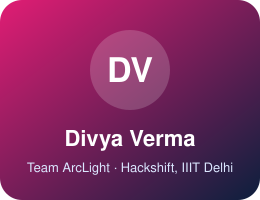<br><b>Divya Verma</b><br><sub>Role: <code>YOUR ROLE</code></sub><br><a href="https://github.com/YOUR-GITHUB"></a><br><a href="https://www.linkedin.com/in/YOUR-HANDLE"></a></td>
</tr>
</table>

| Contribution area | Examples |
|:--|:--|
| 🖥️ Frontend & UX | Next.js app, Synapse accessibility UI, dashboards |
| 🧠 ML & data | Capability Translator, ArcLight models, taxonomy |
| 🤖 AI agents | Gemini routes, bias audit, voice interview |
| 🎨 Design & storytelling | Visuals, demo video, pitch |

<sub>Fill in each member's real role and links, then adjust the contribution table to match.</sub>

</div>

---

## 🔎 Keywords

<details>
<summary><b>Topics this project covers</b></summary>

`capability-intelligence` · `skills-based-hiring` · `talent-operating-system` · `capability-twin` · `verified-skills` · `skill-gap-analysis` · `learning-pathways` · `explainable-ai` · `responsible-ai` · `bias-audit` · `fair-hiring` · `human-in-the-loop` · `resume-parser` · `ats` · `semantic-search` · `sentence-transformers` · `mpnet` · `nlp` · `fastapi` · `nextjs` · `react` · `typescript` · `tailwindcss` · `google-gemini` · `generative-ai` · `ai-agents` · `voice-ai` · `mock-interview` · `proctoring` · `placement-analytics` · `naac` · `nirf` · `edtech` · `hrtech` · `inclusive-hiring` · `accessibility` · `dyslexia` · `hackathon` · `iiit-delhi`

</details>

## 🤝 Contributing

Read [CONTRIBUTING.md](CONTRIBUTING.md) and the [Code of Conduct](CODE_OF_CONDUCT.md). Issues and ideas are welcome. Open an issue first for larger changes, keep real keys out of commits, and keep the **human-in-the-loop** and **no-fabrication** principles intact.

## ⭐ Star history

<a href="https://star-history.com/#Devengoyal885/Access-Hire&Date"></a>

## 📄 License

No license file has been added yet. Add one (for example MIT or Apache-2.0) before inviting outside contributions.

<p align="center">
  
</p>
