<div align="center">

  <!-- Master Hero Image -->
  

  # 🎓 CapAble — Campus Placement Intelligence & Talent Operating System
  ### *The Next-Generation AI-Augmented, 3D-Visualized Career Readiness & Autonomous Recruitment Ecosystem*

  <p align="center">
    <b>Empowering Candidates • Enabling Recruiters • Elevating Universities</b>
  </p>

  <!-- Live Deployment & Hackathon Badges -->
  <p align="center">
    <a href="https://capable-alpha.vercel.app" target="_blank">
      
    </a>
    
    
    
    
    
    
    
    
    
    
  </p>

  <!-- Quick Navigation -->
  <p align="center">
    <a href="#-executive-summary">Executive Summary</a> •
    <a href="#-visual-showcase--screenshots">Visual Gallery</a> •
    <a href="#-ecosystem-pillars--key-features">Key Features</a> •
    <a href="#-ai-resume-studio--templates">Resume Studio</a> •
    <a href="#-hiring-partners--corporate-network">Partners</a> •
    <a href="#%EF%B8%8F-system-architecture">Architecture</a> •
    <a href="#-project-folder-structure">Folder Structure</a> •
    <a href="#%EF%B8%8F-technology-stack">Tech Stack</a> •
    <a href="#-api--data-science-engine-arclight">ArcLight Engine</a> •
    <a href="#-fixing-authentication-on-live-vercel-link">Fix Live Auth</a> •
    <a href="#-getting-started--local-setup">Setup Guide</a> •
    <a href="#%EF%B8%8F-deployment-guide">Deployment</a>
  </p>

</div>

---

## 🌟 Executive Summary

**CapAble** is a unified, intelligent talent operating system architected for the **Smart India Hackathon (SIH 2026)** to address the systemic breakdown in modern campus placements. Traditional recruitment relies on unverified static resumes, keyword-stuffing ATS parsers, and disconnected campus hiring portals.

CapAble fundamentally shifts the paradigm from **"Self-Claimed Resumes"** to **"Verifiable Capabilities & Live Telemetry"**:
1. **Candidates** receive dynamic, 3D holographic capability profiles, real-time code execution with AI mentors, conversational voice interview practice, and targeted skill roadmaps.
2. **Employers** access an AI-powered *Opportunity Radar* that calculates exact competency match matrices against real-world candidate telemetry instead of stale PDFs.
3. **Universities & TPOs** unlock automated cohort analytics, campus drive orchestration, and one-click **NAAC Criterion 5 accreditation reporting**.
4. **Data Scientists & Recruiters** leverage **ArcLight**, a specialized statistical modeling engine re-implementing enterprise SAS predictive models to forecast salary hikes, 15+ LPA high-salary probability, and senior success potential.

---

## 📸 Visual Showcase & Screenshots

<div align="center">

### 🌌 1. Candidate Glassmorphic Hub & Live Telemetry
*Real-time candidate telemetry, live capability radar, and application progress tracker.*

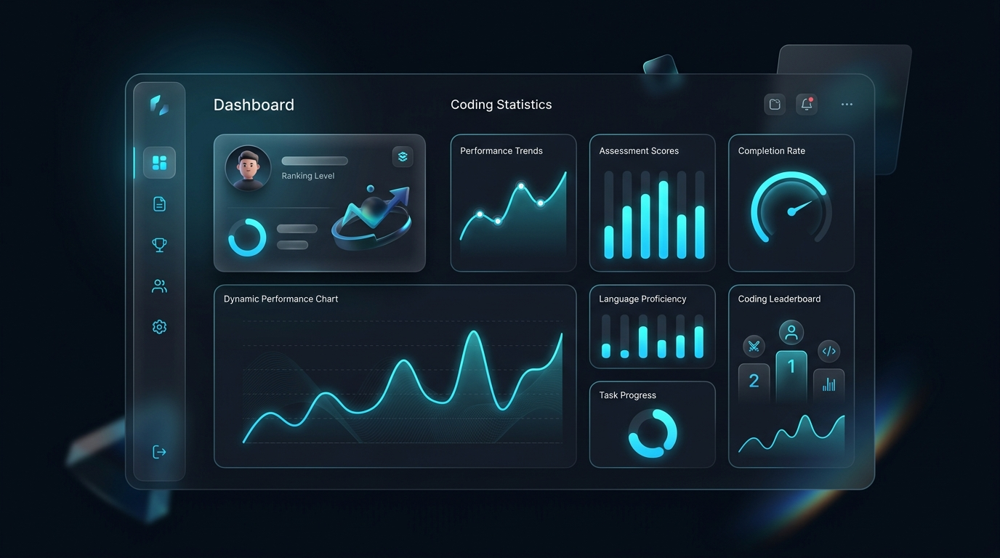

---

### 🪪 2. Interactive 3D Holographic Capability Twin Card
*Physics-based 3D Identity card with WebGL shader reflections and verified skill badges.*

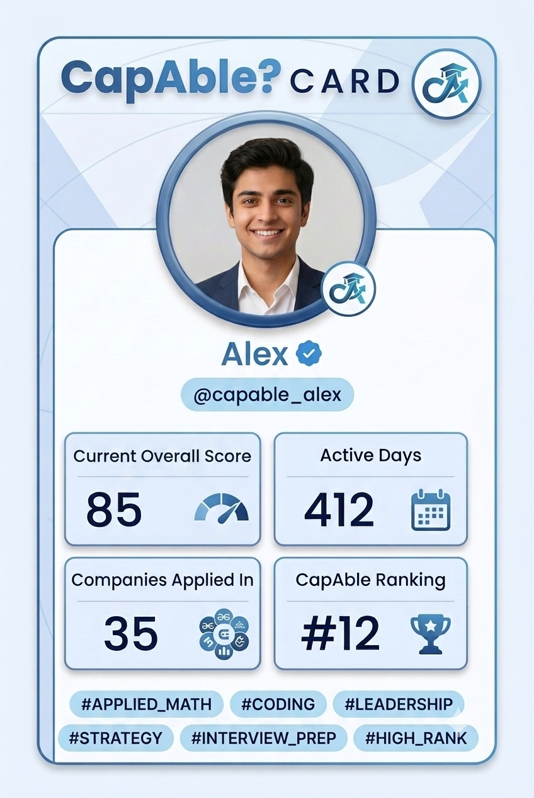

---

### 🎨 3. High-Definition UI & Glassmorphic Art
*Sleek, eye-catching design language built with CSS Glassmorphism and modern dark-mode aesthetic.*

<table width="100%">
  <tr>
    <td width="50%" align="center">
      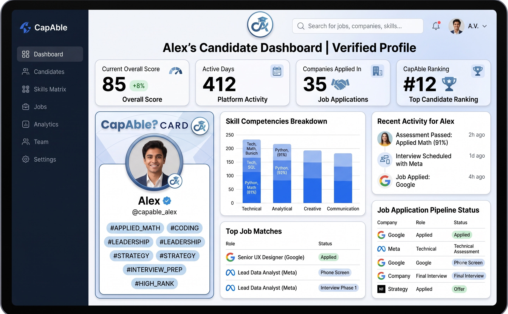
      <p><b>Full-Spectrum Candidate Experience</b></p>
    </td>
    <td width="50%" align="center">
      
      <p><b>Futuristic Talent OS Visual Art</b></p>
    </td>
  </tr>
</table>

</div>

---

## 📄 AI Resume Studio & Templates

CapAble features an integrated in-browser ATS-compliant resume builder powered by **Google Gemini 2.5 Flash**, **PDF.js**, and **html2pdf.js**. Candidates can switch between 5 premium, industry-tested templates:

<div align="center">
  <table>
    <tr>
      <td width="20%" align="center">
        <b>Modern Clean</b><br><br>
        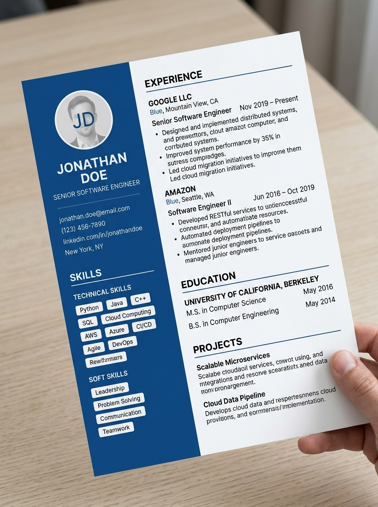
      </td>
      <td width="20%" align="center">
        <b>Academic LaTeX</b><br><br>
        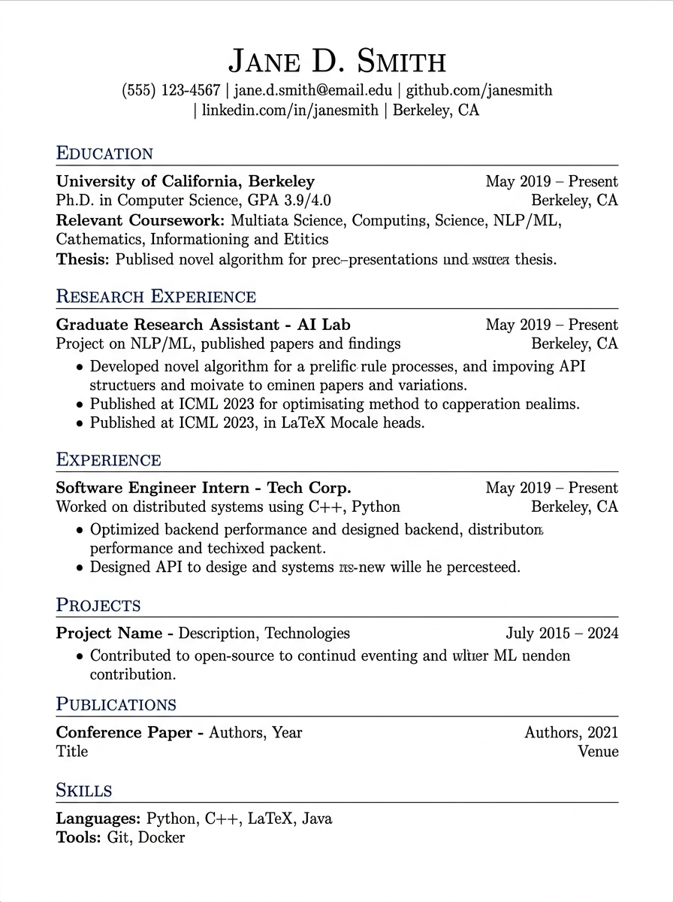
      </td>
      <td width="20%" align="center">
        <b>Creative Portfolio</b><br><br>
        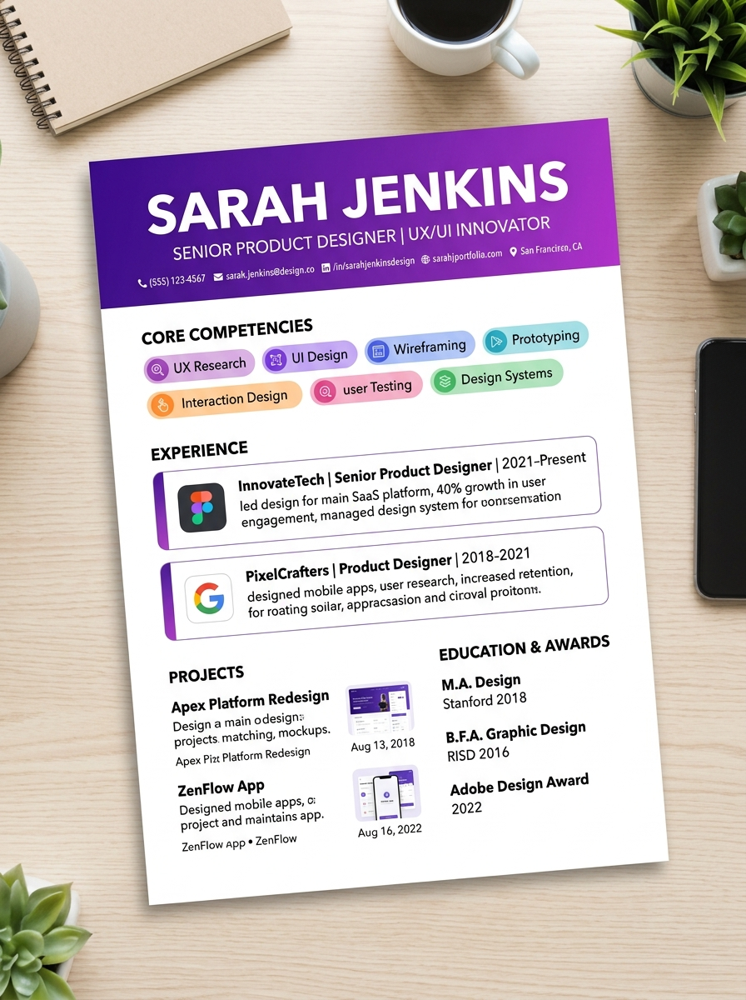
      </td>
      <td width="20%" align="center">
        <b>Executive Corporate</b><br><br>
        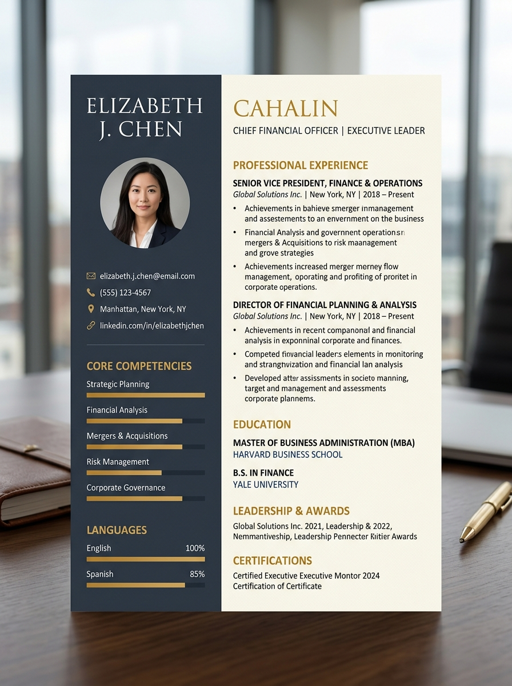
      </td>
      <td width="20%" align="center">
        <b>Minimalist ATS</b><br><br>
        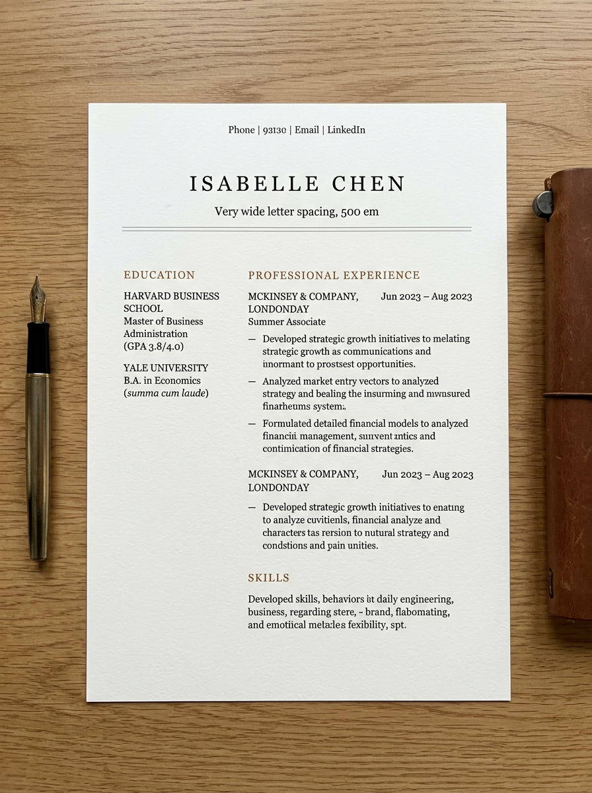
      </td>
    </tr>
  </table>
</div>

---

## 🏢 Hiring Partners & Corporate Network

<div align="center">
  <p><i>Leading enterprises and technology partners supported within the CapAble placement network:</i></p>

  <p>
    
    
    
    
    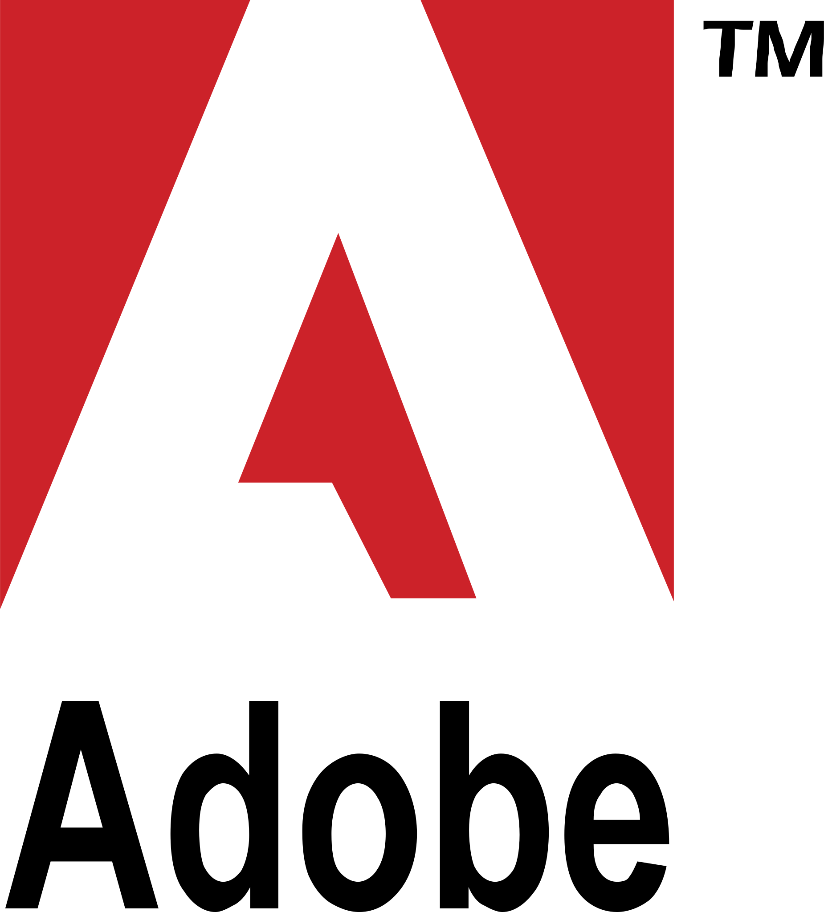
    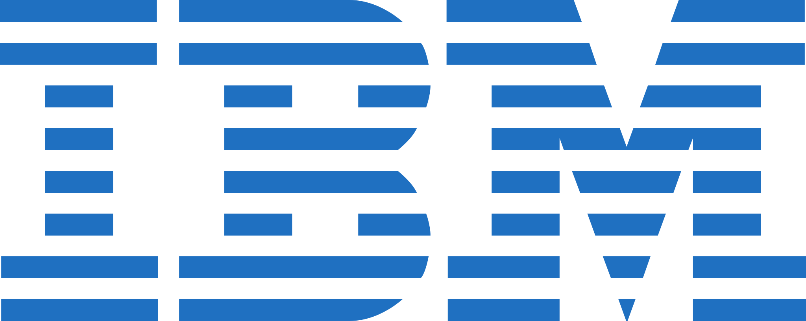
    
    
    
  </p>
</div>

---

## 🚀 Ecosystem Pillars & Key Features

### 1. 👨‍🎓 Candidate Experience (The Talent)
* **🌌 Adaptive Glassmorphic Dashboard:** Real-time metrics hub showing profile strength, application pipelines, upcoming placement drives, and verified capability scores.
* **🪪 3D Capability Twin (`Framer Motion` + `@paper-design/shaders-react`):** Interactive holographic identity card with mouse-reactive 3D tilt, iridescent sheen, and QR profile sharing.
* **💻 In-Browser Monaco Coding IDE:** Integrated VS Code-grade code editor powered by `@monaco-editor/react`, supporting multi-language execution (Python, C++, Java, JS) via Judge0 & Piston APIs with Gemini real-time debugging mentorship.
* **🎙️ AI Voice Interview Simulator (`@vapi-ai/web` + `@vladmandic/face-api`):** Natural conversational voice interview simulator with real audio conversation and browser-based proctoring/face tracking.
* **📄 AI-Tailored Resume Studio (`Gemini 2.5 Flash` + `pdfjs-dist` + `html2pdf.js`):** Extracts text locally from uploaded candidate PDFs, synthesizes non-hallucinated tailored resumes matching specific Job Descriptions, and exports directly to LaTeX, Modern, Minimalist, and Executive formats.
* **📊 Unified Codolio Profile:** Merges verified metrics from LeetCode, HackerRank, and GitHub repositories into a single shareable profile URL (`/u/username`).
* **🎯 Opportunity Radar & Location-Aware Jobs:** Integrates Google Serper API & Remotive API for verified live tech jobs with instant skill gap calculation.
* **🧠 Preparation Hub & Assessments:** Curated Aptitude Tests, Case Studies, Group Discussion (GD) Topics, and Online Assessment (OA) simulators with timed proctoring.
* **🤝 Peer & Community Hub:** Alumni network outreach, peer endorsement forums, and automated professional email generation via Mail IQ.

---

### 2. 🏢 Employer & Recruiter Portal
* **🎯 Real-Time Opportunity Radar:** AI-powered matching algorithm that structurally evaluates candidates against precise role requirements, eliminating keyword fraud.
* **📊 Visual Kanban Pipeline:** Drag-and-drop applicant management pipeline tracking candidates across Applied, Screened, Technical Round, HR Interview, and Offered states.
* **🔍 AI Candidate Deep-Dives:** Instant semantic analysis of candidates' projects, verified coding percentile, and skill strengths without downloading attachments.
* **📅 Synchronized Interview Scheduler:** Automated interview coordinator with calendar triggers and auto-generated candidate assessment sheets.
* **📈 ArcLight Market Intelligence:** Instant industry benchmark statistics comparing offered compensation, experience bands, and top regional hiring hotspots.

---

### 3. 🎓 Institution & University Portal (TPO & Academics)
* **📊 Comprehensive Placement Analytics:** Macro-level dashboard monitoring cohort placement rates, department-level median CTC, and pending offer distributions.
* **📜 NAAC Criterion 5 Auto-Generator:** Generate official institutional reports compliant with NAAC Criterion 5 accreditation standards with a single click.
* **🏢 Placement Drives Administrator:** Manage on-campus and pooled drives, set branch/CGPA cutoff eligibility rules, and broadcast announcements.
* **🛡️ Verifiable Academic Endorsements:** Faculty and department heads can verify student project submissions and award tamper-proof capability tags.

---

### 4. 🧠 ArcLight AI & Data Science Engine
* **Dataset Scale:** Preprocessed and indexed ~12,000 real-world job records (`Analytics Jobs.csv`, `DataScience Jobs.csv`, `JDS Skill Traits.xlsx`, `SDS Personality Traits.xlsx`).
* **Python FastAPI Service (`arclight-api/`):** High-throughput microservice providing real-time statistical inference and market aggregations.
* **SAS Enterprise Model Replication:** Re-implements SAS `PROC LOGISTIC` routines via Python `scikit-learn` pipelines with balanced class weighting:
  * 💰 **Analytics High-Salary Model:** Predicts probability of commanding ₹15+ LPA based on toolchain and domain exposure.
  * 📈 **JDS Salary Hike Predictor:** Evaluates incremental compensation leverage gained by adding high-value competencies (Python, SQL, Cloud, ML).
  * 🏆 **SDS Senior Success Forecaster:** Models probability of sustained high performance in senior analytical and technical leadership positions.

---

## 🔑 Fixing Authentication on Live Vercel Link

> [!IMPORTANT]
> **Why Google Authentication Fails on Live Vercel (`capable-alpha.vercel.app`):**
> Firebase Authentication restricts Google OAuth to an explicit whitelist of **Authorized Domains**.
> When you deploy to a new Vercel domain like `capable-alpha.vercel.app`, Firebase blocks the callback with `auth/unauthorized-domain`.

### 🛠️ 2-Minute Solution in Firebase Console:
1. Open the [Firebase Console](https://console.firebase.google.com/).
2. Select your project: **`wardrobe-app-adf6e`**.
3. In the left navigation menu, go to **Build → Authentication**.
4. Click on the **Settings** tab at the top.
5. Scroll down to the **Authorized domains** section.
6. Click **Add domain** and enter:
   - `capable-alpha.vercel.app`
   - `vercel.app` *(recommended to cover preview deployments)*
7. Click **Done** / **Save**.
8. Refresh your live site — Google login will immediately work!

> [!TIP]
> **Built-in Instant Demo Bypass:**
> We have built an **"⚡ Instant Demo / Guest Access"** button directly on the role cards and login screen!
> Anyone visiting your live link can click "⚡ Demo" to immediately test the **Candidate**, **Employer**, or **University** dashboards with full interactive functionality — zero sign-in required!

---

## 🏛️ System Architecture

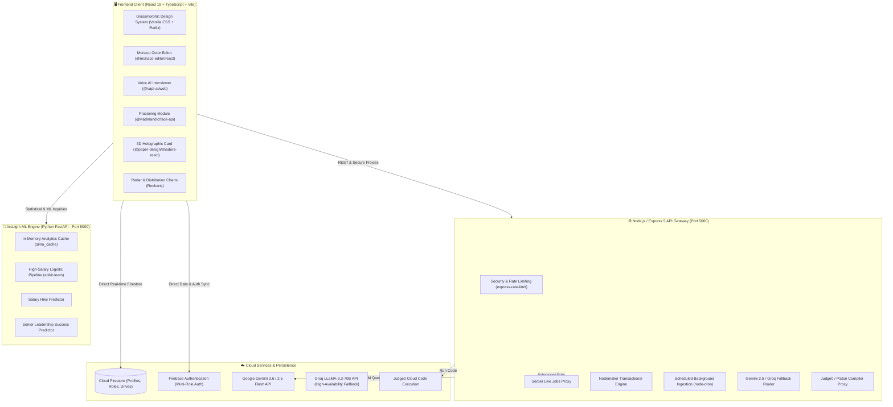

---

## 📁 Project Folder Structure

CapAble is organized into clear architectural domains:

```text
CapAble/
├── 📁 .agents/                  # Autonomous developer skills & agent prompts
├── 📁 ArcLight/                 # Raw datasets & original SAS model artifacts
│   └── 📁 Data Files/Raw_Data/  # Analytics Jobs.csv, DataScience Jobs.csv, Skill Traits
├── 📁 arclight-api/             # Python FastAPI Data Science microservice
│   └── 📄 main.py               # Scikit-learn pipelines replicating SAS PROC LOGISTIC
├── 📁 public/                   # Static assets, 3D models, avatars & illustrations
│   ├── 🖼️ capable-hero.jpg       # Master visual banner
│   ├── 🖼️ capable-dashboard.jpg  # Dashboard preview screenshot
│   ├── 🖼️ hero-glass-art.jpg    # Glassmorphism art
│   ├── 🖼️ thumb_modern.jpg      # Resume template thumbnail: Modern
│   ├── 🖼️ thumb_latex.jpg       # Resume template thumbnail: LaTeX
│   ├── 🖼️ thumb_creative.jpg    # Resume template thumbnail: Creative
│   ├── 🖼️ thumb_executive.jpg   # Resume template thumbnail: Executive
│   ├── 🖼️ thumb_minimal.jpg     # Resume template thumbnail: Minimalist
│   ├── 📁 logos/                # High-res partner SVGs (Google, Amazon, Microsoft...)
│   └── 📄 pdf.worker.min.mjs    # Local PDF.js Web Worker for client-side resume extraction
├── 📁 scripts/                  # Background jobs, NLP parser & cron automation
│   ├── 📄 fetchJobsCron.ts      # Automated real jobs ingestion script
│   └── 📄 nlp_parser.py         # Local Python resume text parser
├── 📁 server/                   # Express.js 5 API Gateway
│   └── 📄 index.ts              # Rate limiter, Serper proxy, Gemini/Groq fallback, Mailer
├── 📁 src/                      # React 19 Frontend application root
│   ├── 📁 assets/               # Bundled visual assets, SIH emblem, 3D textures
│   │   ├── 🖼️ sihlogo.png       # Smart India Hackathon official emblem
│   │   ├── 🖼️ idcard.png        # Holographic 3D card texture
│   │   └── 🖼️ dashboard.png     # Full-resolution dashboard capture
│   ├── 📁 components/           # Reusable UI components
│   │   ├── 📄 BentoGrid.tsx     # Modern bento-grid layout system
│   │   ├── 📄 CapabilityFingerprint.tsx # Dynamic radar charts with Recharts
│   │   ├── 📄 Navbar.tsx        # Responsive multi-role navigation bar
│   │   └── 📄 WebCamProctor.tsx # Facial verification and attention proctoring
│   ├── 📁 context/              # React Context Providers
│   │   ├── 📄 AuthContext.tsx   # Firebase multi-role authentication & mock bypass
│   │   └── 📄 ThemeContext.tsx  # Dynamic dark/light & glassmorphic themes
│   ├── 📁 pages/                # Application routes & portal views
│   │   ├── 📁 candidate/        # Candidate portal (66+ dedicated modules)
│   │   │   ├── 📄 CandidateDashboard.tsx  # Master talent hub
│   │   │   ├── 📄 CodingIDE.tsx           # Monaco in-browser code editor & runner
│   │   │   ├── 📄 AIInterviewSimulator.tsx# Real-time voice interviewer (Vapi AI)
│   │   │   ├── 📄 ResumeAIPage.tsx        # Tailored resume generator with Gemini
│   │   │   ├── 📄 ArcLightPage.tsx        # Salary & hike market intelligence
│   │   │   ├── 📄 CodolioProfilePage.tsx  # Public verified coding portfolio
│   │   │   ├── 📄 OAPlatformPage.tsx      # Timed online assessment simulator
│   │   │   ├── 📄 OpportunitiesPage.tsx   # Real-time job search (Serper + Remotive)
│   │   │   ├── 📄 CareerPage.tsx          # AI career roadmap generator
│   │   │   └── 📄 LearningPage.tsx        # Tailored skill gap learning modules
│   │   ├── 📁 employer/         # Recruiter portal (18 dedicated modules)
│   │   │   ├── 📄 EmployerDashboard.tsx   # Recruiter KPIs & active drives
│   │   │   ├── 📄 TalentPage.tsx          # Real-time capability radar search
│   │   │   ├── 📄 PipelinePage.tsx        # Drag-and-drop Kanban hiring stages
│   │   │   ├── 📄 RolesPage.tsx           # Job role creator & requirements matrix
│   │   │   ├── 📄 InterviewSchedulerPage.tsx # Automated candidate scheduling
│   │   │   └── 📄 InsightsPage.tsx        # Workforce analytics & market trends
│   │   ├── 📁 institution/      # TPO & University portal (13 dedicated modules)
│   │   │   ├── 📄 InstitutionDashboard.tsx# College placement KPIs
│   │   │   ├── 📄 NAACReportPage.tsx      # NAAC Criterion 5 one-click report
│   │   │   ├── 📄 DrivesAdminPage.tsx     # On-campus drive coordination
│   │   │   └── 📄 StudentsPage.tsx        # Student cohort registry & endorsements
│   │   ├── 📁 marketing/        # Public promotional & landing pages
│   │   │   └── 📄 LandingPage.tsx         # Hero showcases, testimonials & CTA
│   │   └── 📁 auth/             # Login, register & role selection views
│   │       └── 📄 LoginPage.tsx           # Multi-role authentication with demo access
│   ├── 📁 services/             # API clients & backend integrations
│   │   ├── 📄 resumeParserService.ts # PDF extraction & Gemini synthesis
│   │   ├── 📄 careerService.ts       # Dynamic capability gap algorithms
│   │   ├── 📄 profileService.ts      # Cloud Firestore profile CRUD
│   │   └── 📄 codeExecutionService.ts# Judge0 & Piston compilation client
│   ├── 📁 stores/               # Zustand global state slices
│   ├── 📁 styles/               # Design tokens, variables & glassmorphic utilities
│   ├── 📁 types/                # Strict TypeScript interfaces & schemas
│   └── 📄 App.tsx               # Master route definitions & role guards
├── 📄 firebase.json             # Firebase hosting & Firestore deployment rules
├── 📄 firestore.rules           # Granular security rules for role-based access
├── 📄 package.json              # Monorepo scripts & dependencies
├── 📄 tsconfig.json             # TypeScript compiler configuration
├── 📄 vite.config.ts            # Vite 8 build pipeline with PWA plugin
└── 📄 README.md                 # Project documentation
```

---

## 🛠️ Technology Stack

| Domain | Technology | Version | Rationale & Use Case |
| :--- | :--- | :--- | :--- |
| **Frontend Core** | **React** | `19.2` | Component-driven architecture capable of rendering complex state-heavy dashboards at 60 FPS. |
| **Language** | **TypeScript** | `6.0` | Comprehensive type safety across Gemini JSON structures, Firestore schemas, and API payloads. |
| **Bundler & HMR** | **Vite** | `8.3` | Instantaneous Hot Module Replacement (HMR) and optimized rollup production bundles. |
| **Routing** | **React Router DOM** | `7.18` | Declarative routing with nested role layouts (`/candidate/*`, `/employer/*`, `/institution/*`). |
| **State Management** | **Zustand** | `5.0` | High-performance, boilerplate-free state stores for candidate telemetry and editor configurations. |
| **UI Aesthetics** | **Vanilla CSS + Glassmorphism** | Modern Spec | Hand-tailored CSS variables, backdrop blurs, glow shadows, and responsive bento grids. |
| **Motion & 3D** | **Framer Motion + Shaders** | `13.4` | Physics-based spring animations, layout transitions, and interactive WebGL canvas shaders. |
| **Code Editor** | **Monaco Editor** | `4.7` | The engine behind VS Code, providing syntax highlighting, autocomplete, and code folding. |
| **Voice AI** | **Vapi AI Web SDK** | `2.7` | Low-latency bi-directional voice streaming for realistic mock interviews. |
| **Computer Vision** | **Face API** | `1.7` | Browser-side face landmark tracking for assessment anti-cheat proctoring. |
| **Data Viz** | **Recharts** | `3.10` | Responsive SVG radar charts, capability trajectories, and salary histograms. |
| **Document Engine** | **PDF.js + html2pdf.js** | Latest | In-browser PDF text extraction and deterministic ATS-friendly PDF generation. |
| **Backend Gateway** | **Express.js** | `5.2` | High-speed API proxy handling rate limiting, Serper requests, and email triggers. |
| **Database & Auth** | **Firebase** | `12.19` | Cloud Firestore real-time NoSQL database and secure multi-role user authentication. |
| **AI LLM Engine** | **Google Gemini** | `3.6 / 2.5` | Fast multi-modal inference for resume synthesis, skill roadmaps, and coding mentorship. |
| **AI Fallback** | **Groq LLaMA-3.3-70B** | Latest | High-availability fallback proxy ensuring zero downtime when Gemini quotas are saturated. |
| **Data Science API** | **FastAPI** | `Python 3.11`| Python microservice with in-memory Pandas caching and Scikit-learn SAS model replication. |

---

## ⚡ API & Data Science Engine: ArcLight

The `arclight-api` microservice (`arclight-api/main.py`) exposes analytical endpoints built over 12,000+ real hiring records:

### Market Intelligence Endpoints (`GET /api/market/*`)
* `GET /api/market/top-roles`: Frequency distributions of high-demand job titles across the tech ecosystem.
* `GET /api/market/salary-distribution`: Normalized percentage breakdown across entry, mid-tier, and senior salary bands.
* `GET /api/market/skill-demand`: Live frequency rankings for in-demand technologies (Python, SQL, PyTorch, React, Cloud).
* `GET /api/market/top-locations`: Geographic aggregation of active tech hiring hubs (Bengaluru, Hyderabad, Pune, Gurgaon, Remote).

### Predictive Modeling Endpoints (`POST /api/predict/*`)
* `POST /api/predict/high-salary`:
  ```json
  // Request Payload
  {
    "experience_years": 4.5,
    "has_python": true,
    "has_sql": true,
    "has_ml": true,
    "location": "Bengaluru"
  }
  // Response Payload
  {
    "high_salary_probability": 0.84,
    "verdict": "High Earning Potential (>= 15 LPA)",
    "recommendation": "Strong alignment. Adding Cloud DevOps (+8%) maximizes offer negotiation."
  }
  ```
* `POST /api/predict/salary-hike`: Estimates percentage increment leverage for upcoming appraisals and role switches.
* `POST /api/predict/senior-success`: Evaluates candidate readiness for Senior / Lead Technical roles.

---

## 💻 Getting Started & Local Setup

### 📋 Prerequisites
* **Node.js**: `v20.x` or higher
* **npm**: `v10.x` or higher
* **Python**: `v3.10` or `v3.11` (for ArcLight Data Science API)
* **Git** installed on your system

---

### 1️⃣ Clone the Repository
```bash
git clone https://github.com/rishabhv16/CapAble.git
cd CapAble
```

---

### 2️⃣ Install Dependencies
```bash
# Install frontend and backend gateway dependencies
npm install

# (Optional) Install Python ArcLight dependencies
cd arclight-api
pip install -r requirements.txt # Or: pip install fastapi uvicorn pandas scikit-learn openpyxl
cd ..
```

---

### 3️⃣ Configure Environment Variables
Create a `.env` file in the root directory by copying the example template:
```bash
cp .env.example .env
```

Ensure the following essential variables are populated:
```env
# Frontend Configuration
VITE_SERVER_URL=http://localhost:5000
VITE_ARCLIGHT_URL=http://localhost:8000

# Firebase Configuration
VITE_FIREBASE_API_KEY="your-firebase-api-key"
VITE_FIREBASE_AUTH_DOMAIN="wardrobe-app-adf6e.firebaseapp.com"
VITE_FIREBASE_PROJECT_ID="wardrobe-app-adf6e"
VITE_FIREBASE_STORAGE_BUCKET="wardrobe-app-adf6e.appspot.com"
VITE_FIREBASE_MESSAGING_SENDER_ID="920220901330"
VITE_FIREBASE_APP_ID="1:920220901330:web:2367f33012d657e43e320b"

# AI Inference Keys (Server-Side)
GEMINI_API_KEY="your-google-gemini-api-key"
GROQ_API_KEYS="your-groq-api-key"

# Live Jobs & Tools
SERPER_API_KEY="your-serper-api-key"
```

---

### 4️⃣ Run the Development Servers

#### Option A: Run Full Stack Simultaneously (Recommended)
```bash
npm run dev:all
```
* Runs the Express Gateway on **`http://localhost:5000`**
* Serves the Vite React Frontend on **`http://localhost:5173`**

#### Option B: Run Services Individually
```bash
# Terminal 1: Frontend
npm run dev

# Terminal 2: Express Gateway Backend
npm run server

# Terminal 3: ArcLight Data Science Engine (Python)
cd arclight-api
python -m uvicorn main:app --port 8000 --reload
```

---

## ☁️ Deployment Guide

CapAble is architected for zero-configuration, high-performance distributed cloud deployment:

### 1. Frontend (Vercel)
1. Import your GitHub repository to [Vercel](https://vercel.com).
2. Framework Preset will automatically be detected as **Vite**.
3. In **Settings -> Environment Variables**, add your `VITE_` variables.
4. Set `VITE_SERVER_URL` to your production backend URL (e.g., your Railway/Render instance).
5. **Crucial:** Add your Vercel URL to [Firebase Console](https://console.firebase.google.com/) under **Authentication → Settings → Authorized domains**.
6. Click **Deploy**.

### 2. Backend Gateway & ArcLight API (Railway / Render)
1. **Node.js Gateway:** Deploy the `server/index.ts` process using `npm run server` with Node 20. Add all server secrets (`GEMINI_API_KEY`, `SERPER_API_KEY`).
2. **Python ArcLight Service:** Deploy `arclight-api/` with start command `uvicorn main:app --host 0.0.0.0 --port $PORT`.

---

## 🏆 Smart India Hackathon (SIH 2026) Alignment

<div align="center">
  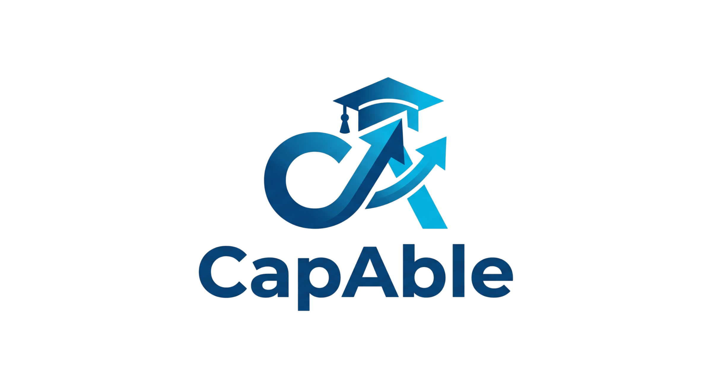
</div>

CapAble directly addresses the core problem statement of campus recruitment friction:
- **Transparent Competency:** Replaces manipulated CGPAs and forged resume lines with real telemetry from Monaco IDE tests, verified GitHub metrics, and proctored OA exams.
- **Fair Opportunity Access:** Connects Tier-2 and Tier-3 college talent with visionary companies based purely on capability matching.
- **Institutional Compliance:** Eliminates hundreds of manual hours for college placement cells by automating NAAC accreditation reports.

---

## 📄 License & Acknowledgments

This project is licensed under the **MIT License** — feel free to use, modify, and build upon this platform for academic and commercial use.

<div align="center">
  <br />
  <p><b>Built with ❤️ by Team CapAble for Smart India Hackathon 2026</b></p>
  <p><i>Transforming campus talent readiness into measurable, verifiable capability.</i></p>
  <br />
</div>
