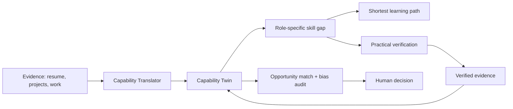

<p align="center">
  
</p>

<p align="center">
  <a href="https://capable-alpha.vercel.app"></a>
  <a href="https://www.youtube.com/watch?v=InX9qLdTvsY"></a>
  
  
  
</p>

# CapAble: Adaptive Capability Twin for an Inclusive Workforce

> A résumé is a claim. A Capability Twin is a record.

CapAble is Team Arc Light's entry for **SAP Hackfest 2026 (IIIT Delhi), Theme 2: Inclusive Workforce.** It makes what a person can actually do visible, checks it through practical work, and keeps that record up to date, so hiring and career moves are decided on capability instead of pedigree, degree titles or career gaps.

## Contents

[Quick links](#quick-links) · [Problem](#the-problem) · [Solution](#our-solution) · [Demo](#demo-video) · [Theme 2 fit](#how-capable-fits-theme-2) · [Status](#project-status-what-is-built-and-what-is-not) · [Capability engine](#the-capability-twin-engine) · [Architecture](#architecture) · [ML service](#ml-service) · [Run locally](#run-the-frontend-locally) · [Gallery](#gallery) · [Roadmap](#roadmap) · [Responsible AI](#responsible-ai-and-privacy) · [Team](#team)

## Quick links

| Resource | Link |
|---|---|
| Live prototype | https://capable-alpha.vercel.app |
| Demo video | https://www.youtube.com/watch?v=InX9qLdTvsY |
| Frontend repository | https://github.com/Devengoyal885/Access-Hire |
| Machine learning repository | https://github.com/Devengoyal885/accesshireml |
| Trained model (Hugging Face) | https://huggingface.co/Devengoyal/accesshire-mpnet-final |
| Dataset (Google Drive) | https://drive.google.com/drive/folders/17lZrwG7Z14cZZMHHAoW76IvVGWXqVab2 (you may need to request access) |
| Showcase page | [`showcase/index.html`](showcase/index.html) |

## The problem

Talent is not scarce, but capability is often hidden. Static résumés, degree and employer-name filters, self-declared skills and career gaps push capable people out of the funnel. Employers, in turn, cannot easily verify what a candidate can do, and institutions cannot see the real skill picture of their students.

<p align="center"></p>

## Our solution

CapAble replaces the static résumé with a **living Capability Twin** and moves each person through one loop: understand evidence, translate it to capabilities, find the gap to a target role, verify with practical work, and match fairly.

<p align="center"></p>



## Demo video

[](https://www.youtube.com/watch?v=InX9qLdTvsY)

Click the image to watch the demo on YouTube.

## How CapAble fits Theme 2

SAP's Hackfest 2026 page describes the Inclusive Workforce theme as designing systems where fairness is an architectural principle, and it expects solutions where each agent has a clear role and explicit handoffs to humans. The table maps our work to that, based on a read of the code in the linked repositories.

| Theme 2 idea | What CapAble does | Status |
|---|---|---|
| Make skills visible beyond a résumé | Capability Translator: FastAPI service with an `all-mpnet-base-v2`-based model against a 469-capability taxonomy, with an explainability breakdown | In the repositories |
| Learning and reskilling | Learning-pathway agent (Gemini) and a data file of SAP Learning Hub courses | In the repositories |
| Fair matching | Opportunity-match agent, with an evidence trail for each match | In the repositories |
| Fairness as architecture | Bias-audit agent (Gemini) and an enterprise workforce console; AI recommends and a human decides | Bias-audit route in the repositories; broader fairness agents planned |
| Accessibility | Synapse UI toggle for OpenDyslexic type and high-contrast reading modes | In the repositories |
| Proof of capability | 4-step practical verification flow shown in the Action Center | Prototype flow; automatic task generation and scoring not built |
| People and skills data | Demo personas in `lib/mockData.ts` | Demo data only |

> Note for the team: we could not open SAP's full theme brief, only its public summary. Paste the exact Theme 2 problem statement into this section so the wording matches what judges will read.

## Project status: what is built and what is not

We would rather be exact than impressive.

**In the frontend and ML repositories (verified by reading the code):**
- Next.js app with dashboard, capability, opportunities, resume, actions, workspace, workforce, profile and roadmap pages.
- Four server-side agent routes: `translate-capability`, `learning-pathway`, `opportunity-match`, `bias-audit`.
- FastAPI ML service with four endpoints and precomputed capability embeddings.
- Synapse UI accessibility toggle.
- Demo data uses sample personas, not real people.

**Deployed prototype (capable-alpha.vercel.app):** an internal audit dated 2026-09-25 found **40 of 137 audited features fully built, 13 partial or new, and 84 not built.**

<p align="center"></p>

| Area | Working today |
|---|---|
| Candidate career | AI career-path mapping, skill-gap analysis, personalised learning paths, QR-linked certificates, public profile, portfolio with GitHub sync, resume tailoring, ATS score |
| Interview prep | AI voice mock interview, session history and statistics, filler-word counter |
| Institution | Placement dashboard, bulk CSV invite, NAAC/NIRF report, faculty dashboard, skill-matrix export |
| Employer | Role posting, candidate pipeline, offer-letter generation, interview scheduling |
| Platform | Role-based security rules, in-app notifications, dark mode |

**Not built yet:** equity-nudge and job-fairness agents, automated bias-audit reports in the deployed app, auto-scored practical tasks, WCAG compliance, mobile app. Details: [`docs/FEATURE_AUDIT.md`](docs/FEATURE_AUDIT.md).

## The Capability Twin engine

<p align="center"></p>

A Twin describes six dimensions of each capability: **proficiency, context, evidence, confidence, recency and autonomy.** The loop is the core idea: new work becomes new evidence, which updates the Twin and improves future matching. Verification is a flow in the prototype today; the automated scoring step is planned.

## Architecture

<p align="center"></p>

Solid boxes exist in the repositories. Dashed boxes are planned.

| Layer | Technology | Source |
|---|---|---|
| Web app | Next.js 16.3.1, React 19, TypeScript, Tailwind CSS 4, Framer Motion, Recharts, Zustand, lucide-react | `Access-Hire/package.json` |
| Server API routes | `translate-capability`, `learning-pathway`, `opportunity-match`, `bias-audit` | `Access-Hire/app/api/agents/` |
| ML inference | FastAPI, sentence-transformers, PyTorch 2.3.1 (CPU), scikit-learn, pandas | `accesshireml/requirements.txt`, `Dockerfile` |
| Generative agents | Google Gemini Flash | `Access-Hire/lib/gemini.ts` |
| Authentication | Supabase (see `.env.example`) | `Access-Hire/.env.example` |
| Accessibility | Synapse context (OpenDyslexic, high contrast) | `Access-Hire/lib/synapse-context.tsx` |
| Deployment | Frontend on Vercel; ML service ships with a Dockerfile | live prototype, `accesshireml/Dockerfile` |

The deployed prototype's audit also mentions Firestore, a Vapi voice interview and Firebase email triggers. Those belong to the deployed app, so check its own code for them.

## ML service

The `accesshireml` repository is a FastAPI service with a precomputed embedding file (`capability_embeddings.npy`), a capability list (`capability_names.json`) and a CSV in `data/`.

| Method | Path | Purpose |
|---|---|---|
| GET | `/` | Service info |
| GET | `/health` | Health check |
| GET | `/capabilities` | List known capabilities |
| POST | `/infer-capabilities` | Infer capabilities from free text (`text`, optional `top_k` 1 to 20, default 8) |

```bash
git clone https://github.com/Devengoyal885/accesshireml.git
cd accesshireml
pip install -r requirements.txt        # or: docker build -t accesshire-ml .
uvicorn app.main:app --host 0.0.0.0 --port 8000

curl -X POST http://localhost:8000/infer-capabilities \
  -H "Content-Type: application/json" \
  -d '{"text": "Led a volunteer team and built a budgeting spreadsheet", "top_k": 5}'
```

The repository has no README and we publish no accuracy figures. See the [model card](https://huggingface.co/Devengoyal/accesshire-mpnet-final) for what it documents.

## Run the frontend locally

Requirements: Node.js 20 or later and npm.

```bash
git clone https://github.com/Devengoyal885/Access-Hire.git
cd Access-Hire
npm install
cp .env.example .env.local     # then fill in your own values
npm run dev                    # http://localhost:3000
```

| Variable | Used for |
|---|---|
| `GOOGLE_GEMINI_API_KEY` | Server-side Gemini calls |
| `NEXT_PUBLIC_GEMINI_API_KEY` | Exposed to the browser. Avoid in production; use the server-side key |
| `NEXT_PUBLIC_SUPABASE_URL`, `NEXT_PUBLIC_SUPABASE_ANON_KEY` | Supabase authentication |
| `ACCESSHIRE_ML_API_URL` | URL of the running ML service |

Never commit real keys. Other scripts: `npm run build`, `npm run start`, `npm run lint`. The repository's `AGENTS.md` warns that Next.js 16 has breaking changes, so read `node_modules/next/dist/docs/` before framework-level changes.

## Gallery

These are illustrations, not screenshots. Add real screenshots in [`assets/screenshots/`](assets/screenshots/README.md).

<table>
  <tr>
    <td align="center"><br><sub>Learning and upskilling</sub></td>
    <td align="center"><br><sub>Institutions and placements</sub></td>
  </tr>
  <tr>
    <td align="center"><br><sub>Verified capability</sub></td>
    <td align="center"><br><sub>Workforce insight</sub></td>
  </tr>
</table>

## Roadmap

| Phase | Work |
|---|---|
| Before the final | Move the Gemini key behind a backend, replace the demo-data paths with one clean flow, record a short demo of the loop end to end |
| Next | Auto-generated and auto-scored practical tasks, equity-nudge and job-fairness agents, bias-audit reports in the deployed app |
| Then | Institution drive-management admin UI, job recommendations in the opportunities page, employer funnel analytics |
| Later | PWA and notifications, WCAG accessibility work, multilingual support, enterprise HR integrations |

## Responsible AI and privacy

- AI recommends and a human decides. Match and bias-audit outputs are meant for human review.
- Every capability carries evidence and an explanation, so a result can be questioned.
- Role-based security rules protect data in the deployed prototype.
- We make no compliance claims. Keep real personal data out of the demo and share datasets only with permission.

## Team

**Arc Light** — Deven, Rishabh Verma, Aditya Singh, V. Naveen Shankar, Ansh Chaudhary, Parkhee Jha.

SAP Hackfest 2026, IIIT Delhi, Theme 2: Inclusive Workforce.

## License

No license file has been added yet. Add one (for example MIT or Apache-2.0) before inviting outside contributions.
