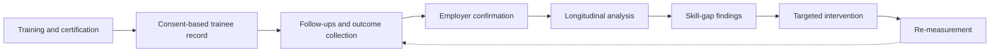

<p align="center">
  
</p>

<p align="center">
  <a href="https://capable-alpha.vercel.app"></a>
  <a href="https://www.youtube.com/watch?v=InX9qLdTvsY"></a>
  
  
</p>

# CapAble

**Longitudinal Skilling Outcome & Impact Intelligence Platform**

> Training completion is not the finish line. CapAble is built to measure what happens next.

CapAble is our response to **SIH26135: difficulties in tracking employment outcomes, skill gaps, and the impact of skilling initiatives.** It connects students, training institutions and employers around one evidence-based record of capability, so programmes can see which skills turn into real opportunities and where the gaps are.

## Contents

[Quick links](#quick-links) · [Problem](#the-problem) · [Approach](#our-approach) · [Demo](#demo-video) · [Status](#project-status-what-is-built-and-what-is-not) · [Capability engine](#the-capability-twin-engine) · [Architecture](#architecture) · [ML service](#ml-service) · [Run locally](#run-the-frontend-locally) · [Gallery](#gallery) · [Roadmap](#roadmap) · [Privacy](#privacy-and-responsible-use) · [Team](#team)

## Quick links

| Resource | Link |
|---|---|
| Live prototype | https://capable-alpha.vercel.app |
| Demo video | https://www.youtube.com/watch?v=InX9qLdTvsY |
| Frontend repository | https://github.com/Devengoyal885/Access-Hire |
| Machine learning repository | https://github.com/Devengoyal885/accesshireml |
| Trained model (Hugging Face) | https://huggingface.co/Devengoyal/accesshire-mpnet-final |
| Dataset (Google Drive) | https://drive.google.com/drive/folders/17lZrwG7Z14cZZMHHAoW76IvVGWXqVab2 (you may need to request access) |
| Showcase page | [`showcase/index.html`](showcase/index.html) |

## The problem

Skilling programmes report how many people completed training. Few can say what happened afterwards: who found work, who kept the job, whose wages grew, and which missing skills held people back. Without that follow-up data, institutions cannot improve courses and administrators cannot compare programmes fairly.

<p align="center"></p>

## Our approach

CapAble follows a five-step loop. Each step feeds the next, and the last step feeds back into the first.

<p align="center"></p>



This is the target workflow for SIH26135. The [status section](#project-status-what-is-built-and-what-is-not) says which parts exist today.

## Demo video

[](https://www.youtube.com/watch?v=InX9qLdTvsY)

Click the image to watch the demo on YouTube.

## Project status: what is built and what is not

We would rather be exact than impressive. The numbers below come from our internal codebase audit dated 2026-09-25.

<p align="center"></p>

**40 of 137 audited features are fully built, 13 are partial or newly added, and 84 are not built yet.** The prototype covers:

| Area | Working today |
|---|---|
| Candidate career | AI career-path mapping, skill-gap analysis, personalised learning paths, QR-linked verifiable certificates, public profile, portfolio with GitHub sync, resume tailoring, ATS score |
| Interview prep | AI voice mock interview, session history and statistics, live filler-word counter |
| Institution (TPO) | Placement dashboard, bulk CSV student invite, NAAC/NIRF report, faculty dashboard, CSV skill-matrix export |
| Employer | Role posting, candidate pipeline, offer-letter generation, interview scheduling |
| Platform | Role-based Firestore security rules, in-app notifications, dark mode |

**SIH26135-specific features that are not built yet** (see [Roadmap](#roadmap)): automated trainee follow-ups, employer confirmation of employment and retention, longitudinal wage and attrition analytics, and outcome-driven intervention tracking. The existing institution dashboard, pipeline and skill-gap analysis are the foundation these will build on.

Full detail: [`docs/FEATURE_AUDIT.md`](docs/FEATURE_AUDIT.md).

## The Capability Twin engine

The repositories linked above implement the AccessHire **Adaptive Capability Twin**, the skills-intelligence layer behind CapAble. A résumé is a claim; a Capability Twin is a record that is updated whenever new evidence arrives.

<p align="center"></p>

A Twin describes six dimensions of each capability: **proficiency, context, evidence, confidence, recency and autonomy.** Capabilities are inferred from free text using an `all-mpnet-base-v2`-based model against a 469-capability taxonomy, then shown with an explainability breakdown (semantic similarity, keyword overlap, evidence weighting).

## Architecture

<p align="center"></p>

Solid boxes exist in the repositories. Dashed boxes are planned.

| Layer | Technology | Source |
|---|---|---|
| Web app | Next.js 16.3.1, React 19, TypeScript, Tailwind CSS 4, Framer Motion, Recharts, Zustand, lucide-react | `Access-Hire/package.json` |
| Server API routes | `translate-capability`, `learning-pathway`, `opportunity-match`, `bias-audit` | `Access-Hire/app/api/agents/` |
| ML inference | FastAPI, sentence-transformers, PyTorch 2.3.1 (CPU), scikit-learn, pandas | `accesshireml/requirements.txt`, `Dockerfile` |
| Generative agents | Google Gemini | `Access-Hire/lib/gemini.ts` |
| Authentication | Supabase (see `.env.example`) | `Access-Hire/.env.example` |
| Deployment | Frontend on Vercel; ML service ships with a Dockerfile | live prototype, `accesshireml/Dockerfile` |

The live prototype's feature audit also lists Firestore, a Vapi-based voice interview and Firebase email triggers. Those belong to the deployed CapAble application, so treat the table above as the stack of the two linked repositories, and check the deployed app's own code for the rest.

## ML service

The `accesshireml` repository is a FastAPI service with a precomputed capability-embedding file (`capability_embeddings.npy`), the capability list (`capability_names.json`) and a CSV in `data/`. Its endpoints, from `app/main.py`:

| Method | Path | Purpose |
|---|---|---|
| GET | `/` | Service info |
| GET | `/health` | Health check |
| GET | `/capabilities` | List known capabilities |
| POST | `/infer-capabilities` | Infer capabilities from free text (`text`, optional `top_k` from 1 to 20, default 8) |

```bash
git clone https://github.com/Devengoyal885/accesshireml.git
cd accesshireml
pip install -r requirements.txt        # or: docker build -t accesshire-ml .
uvicorn app.main:app --host 0.0.0.0 --port 8000

curl -X POST http://localhost:8000/infer-capabilities \
  -H "Content-Type: application/json" \
  -d '{"text": "Managed a community workshop and built a budgeting spreadsheet", "top_k": 5}'
```

The repository has no README of its own, and we have not published accuracy figures. Read the [model card](https://huggingface.co/Devengoyal/accesshire-mpnet-final) for what it documents.

## Run the frontend locally

Requirements: Node.js 20 or later and npm.

```bash
git clone https://github.com/Devengoyal885/Access-Hire.git
cd Access-Hire
npm install
cp .env.example .env.local     # then fill in your own values
npm run dev                    # http://localhost:3000
```

Environment variables (from `.env.example`):

| Variable | Used for |
|---|---|
| `GOOGLE_GEMINI_API_KEY` | Server-side Gemini calls |
| `NEXT_PUBLIC_GEMINI_API_KEY` | Exposed to the browser. Avoid this in production and use only the server-side key |
| `NEXT_PUBLIC_SUPABASE_URL`, `NEXT_PUBLIC_SUPABASE_ANON_KEY` | Supabase authentication |
| `ACCESSHIRE_ML_API_URL` | URL of the running ML service |

Never commit real keys. Other scripts: `npm run build`, `npm run start`, `npm run lint`. This repository's `AGENTS.md` notes that Next.js 16 has breaking changes, so read the docs in `node_modules/next/dist/docs/` before changing framework-level code.

## Gallery

The images below are illustrations, not screenshots of the app. Add real screenshots in [`assets/screenshots/`](assets/screenshots/README.md).

<table>
  <tr>
    <td align="center"><br><sub>Training and certification</sub></td>
    <td align="center"><br><sub>Campus placement drives</sub></td>
  </tr>
  <tr>
    <td align="center"><br><sub>Employer verification</sub></td>
    <td align="center"><br><sub>Impact analytics</sub></td>
  </tr>
</table>

## Roadmap

From our audit's prioritised list, plus the SIH26135 outcome-tracking work.

| Phase | Work |
|---|---|
| Now: fix first | Move the Gemini key behind a backend (it is exposed in the frontend today), install the Firebase "Trigger Email" extension so queued emails send, add the institution drive-management admin UI, show job recommendations in the opportunities page |
| Next: outcome tracking | Trainee follow-up scheduler, employer confirmation of status, role and retention, longitudinal store by cohort and course, wage, retention and attrition analytics |
| Then: assessment and polish | Larger question bank, randomised order and review flags, automated shortlisting rules, employer funnel analytics, campus drive calendar |
| Later: scale | PWA and browser push notifications, WhatsApp alerts, ERP/LMS integration, multilingual support, WCAG accessibility work |

## Privacy and responsible use

- Trainee records are intended to be **consent-based**, with **role-based access** (Firestore security rules are in place in the prototype).
- Reported and verified outcomes must stay clearly separate once outcome tracking is built.
- Capability and outcome scores support human decisions and do not replace them.
- We make no legal-compliance claims. Do not load real personal data into the prototype or share datasets without permission.

## Team

**Arc Light** — Deven, Rishabh Verma, Aditya Singh, V. Naveen Shankar, Ansh Chaudhary, Parkhee Jha.

Smart India Hackathon, problem statement **SIH26135**.

## License

No license file has been added yet. Add one (for example MIT or Apache-2.0) before inviting outside contributions.
