<p align="center">
  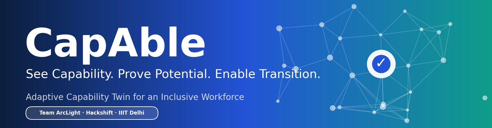
</p>

<p align="center">
  <a href="https://readme-typing-svg.demolab.com">
    
  </a>
</p>

<p align="center">
  <a href="https://capable-alpha.vercel.app"></a>
  <a href="https://www.youtube.com/watch?v=InX9qLdTvsY"></a>
</p>

<p align="center">
  
  
  
  
  
  
  
  
  
</p>

<h1 align="center">CapAble — Capability Intelligence & Talent Operating System</h1>

<p align="center"><b>Hiring on what people can <i>do</i>, not where they studied, what they were titled, or how long their résumé is.</b></p>

---

## 🧭 Contents

[Quick links](#-quick-links) · [Problem](#-the-problem) · [Solution](#-our-solution) · [Demo](#-demo) · [Impact](#-impact-at-a-glance) · [Capability Twin](#-the-capability-twin) · [Ecosystem](#-one-platform-four-stakeholders) · [Features](#-feature-showcase) · [AI engine](#-the-ai-engine) · [Integrity](#-proctoring--integrity) · [Architecture](#-architecture) · [Status](#-honest-project-status) · [Run locally](#-run-it-locally) · [Gallery](#-gallery) · [Roadmap](#-roadmap) · [Responsible AI](#-responsible-ai--privacy) · [Team](#-team-arclight)

---

## 🔗 Quick links

| | Resource | Link |
|---|---|---|
| 🚀 | **Live prototype** | https://capable-alpha.vercel.app |
| 🎬 | **Demo video** | https://www.youtube.com/watch?v=InX9qLdTvsY |
| 💻 | **Frontend repository** | https://github.com/Devengoyal885/Access-Hire *(copy in [`frontend/`](frontend/))* |
| 🧠 | **Machine learning repository** | https://github.com/Devengoyal885/accesshireml *(copy in [`ml-service/`](ml-service/))* |
| 🤗 | **Trained model (Hugging Face)** | https://huggingface.co/Devengoyal/accesshire-mpnet-final |
| 📦 | **Dataset (Google Drive)** | https://drive.google.com/drive/folders/17lZrwG7Z14cZZMHHAoW76IvVGWXqVab2 *(you may need to request access)* |
| 🖼️ | **Showcase page** | [`showcase/index.html`](showcase/index.html) |
| 📋 | **Feature audit** | [`docs/FEATURE_AUDIT.md`](docs/FEATURE_AUDIT.md) |

---

## 💥 The problem

> **Talent is not scarce. Capability is hidden.**

Static résumés, degree and employer-name filters, self-declared skills and career gaps push capable people out of the funnel. Employers cannot verify what a candidate can really do, and institutions cannot see the true skill picture of their own students.

| 😟 Candidate | 🏢 Employer | 🏛️ Institution |
|---|---|---|
| Strong work, weak pedigree → filtered out | Keyword-stuffed PDFs, no proof | Placement data is scattered and manual |
| Career gaps read as red flags | Hiring on brand names, not skill | NAAC / NIRF reporting is painful |
| No clear path from "now" to "target role" | Bias creeps into shortlists | No view of curriculum vs market gap |

<p align="center">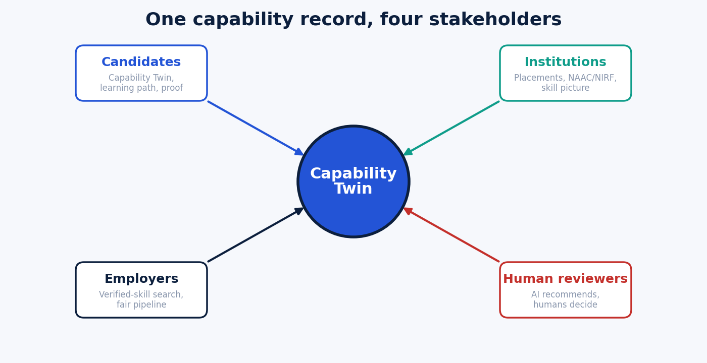</p>

---

## 💡 Our solution

CapAble replaces the static résumé with a **living Capability Twin** and moves every person through a single loop:

**Understand evidence → Translate to capabilities → Find the gap → Verify with real work → Match fairly → Human decides.**

<p align="center">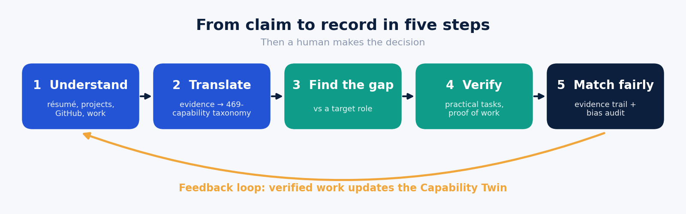</p>

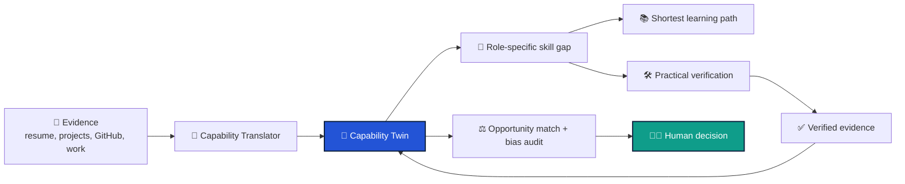

---

## 🎬 Demo

[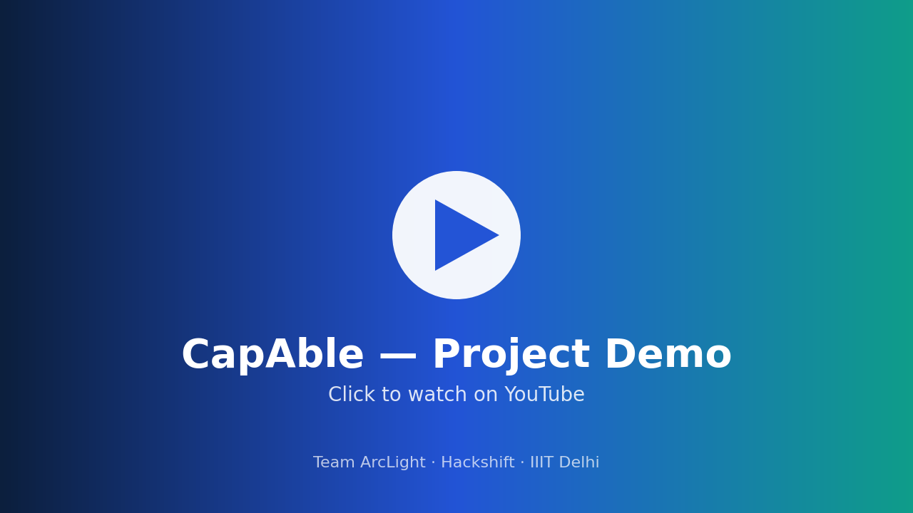](https://www.youtube.com/watch?v=InX9qLdTvsY)

<p align="center"><i>Click the image to watch the demo on YouTube, or try the <a href="https://capable-alpha.vercel.app">live prototype</a>.</i></p>

---

## 📊 Impact at a glance

<table align="center">
  <tr>
    <td align="center"><h2>469</h2><sub>capabilities in the<br/>translator taxonomy</sub></td>
    <td align="center"><h2>12,000+</h2><sub>real hiring records<br/>behind ArcLight analytics</sub></td>
    <td align="center"><h2>4</h2><sub>stakeholder portals<br/>on one shared record</sub></td>
    <td align="center"><h2>6</h2><sub>dimensions per<br/>capability in the Twin</sub></td>
  </tr>
  <tr>
    <td align="center"><h2>4</h2><sub>server-side AI<br/>agent routes</sub></td>
    <td align="center"><h2>4</h2><sub>job sources aggregated<br/>and de-duplicated</sub></td>
    <td align="center"><h2>3</h2><sub>predictive models<br/>(salary, hike, seniority)</sub></td>
    <td align="center"><h2>0</h2><sub>fabricated résumé claims:<br/>AI only uses verified records</sub></td>
  </tr>
</table>

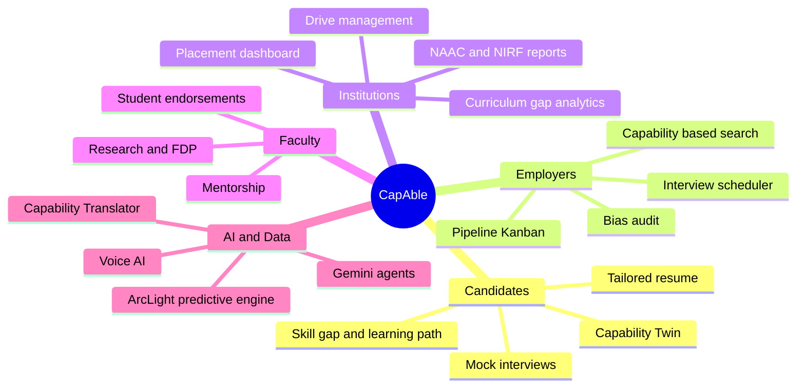

---

## 🧬 The Capability Twin

<p align="center">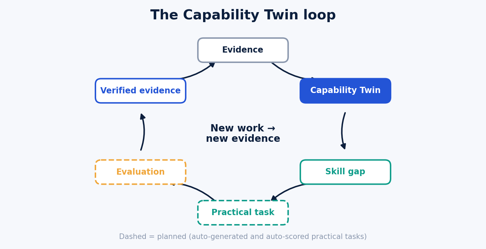</p>

A Twin describes every capability across **six dimensions**:

| Dimension | Question it answers |
|---|---|
| 🎚️ **Proficiency** | How good is the person at it? |
| 🧩 **Context** | Where and how was it used? |
| 📎 **Evidence** | What proves it? (projects, repos, assessments) |
| 🔒 **Confidence** | How sure are we? |
| ⏱️ **Recency** | How fresh is the skill? |
| 🦅 **Autonomy** | Can they do it independently? |

New work becomes new evidence → the Twin updates → future matching improves.

---

## 🌐 One platform, four stakeholders

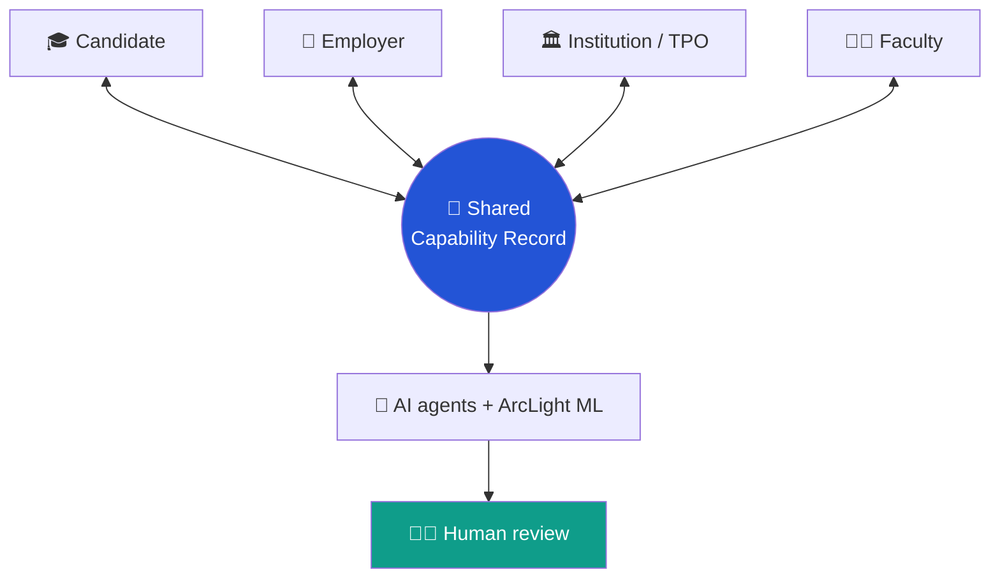

---

## ✨ Feature showcase

> Status legend: ✅ working in the deployed prototype · 🧪 prototype / partial · 🗺️ planned. See [Honest project status](#-honest-project-status) for the audit.

### 🎓 Candidate

| Feature | What it does | Status |
|---|---|---|
| **3D holographic identity card** | Spring-tilt physics, specular glare, capability-confidence ring, verification watermark | ✅ |
| **Capability matrix & readiness score** | Verified skills (0–100%) and a composite career-readiness score | ✅ |
| **Peer benchmarking** | College and branch percentile ranking | ✅ |
| **Skill gap → learn → opportunity loop** | Finds the two weakest skills with 1-click *Learn*, *Assess*, *Roles* | ✅ |
| **AI learning pathways** | Milestone-based curriculum from Gemini, linked to docs, videos and repos | ✅ |
| **Resume Studio** | ATS score, job-tailored resume, **no-fabrication engine** limited to verified projects | ✅ |
| **Career roadmap** | Role-transition simulation with exact missing requirements | ✅ |
| **Portfolio & public profile** | GitHub telemetry sync, shareable `/u/:username`, QR-linked certificates | ✅ |
| **AI voice mock interview** | Speech-to-speech via Vapi + Gemini, with clarity, confidence and filler-word analytics | ✅ |
| **Coding IDE, aptitude, case-study & GD arena** | Monaco editor, Piston/Judge0 runner, timed aptitude with history | 🧪 |
| **MailIQ outreach** | Personalised recruiter cold emails with subject-line optimisation | 🧪 |

### 🏢 Employer

| Feature | What it does | Status |
|---|---|---|
| **Talent Radar** | Search by verified skill and minimum score (e.g. React ≥ 85%), not keywords | ✅ |
| **Candidate comparison** | Side-by-side radar-chart comparison | 🧪 |
| **Role posting & match matrix** | Post roles; auto-match against enrolled students | ✅ |
| **Pipeline (ATS)** | Applied → Shortlisted → Round 1 → Technical → Offer → Hired | ✅ |
| **Interview scheduler & offer letters** | Slot coordination, invites, offer-letter generation | ✅ |

### 🏛️ Institution & Faculty

| Feature | What it does | Status |
|---|---|---|
| **Placement dashboard** | Enrolled, placed, placement %, average and highest CTC | ✅ |
| **Bulk CSV invite & skill-matrix export** | Onboard cohorts and export skill data | ✅ |
| **NAAC / NIRF reporting** | Criterion 5 tables with print/PDF export | ✅ |
| **Faculty dashboard & endorsements** | Cohort progress and institutional skill endorsements | ✅ |
| **Drive management admin, multi-channel comms, curriculum-gap analytics** | Eligibility rules, broadcasts, syllabus insights | 🗺️ |

### ♿ Inclusion & accessibility

| Feature | What it does | Status |
|---|---|---|
| **Synapse UI** | One-tap OpenDyslexic typeface and high-contrast reading modes | ✅ |
| **Bias-audit agent** | Flags skewed shortlists for human review | 🧪 |
| **Equity-nudge & job-fairness agents** | Proactive fairness checks across the funnel | 🗺️ |

---

## 🤖 The AI engine

### 🧠 Capability Translator (ML service)
FastAPI service built on an `all-mpnet-base-v2` model fine-tuned on a **469-capability taxonomy**, with precomputed embeddings and an explainability breakdown for every inference.

| Method | Path | Purpose |
|---|---|---|
| GET | `/` | Service info |
| GET | `/health` | Health check |
| GET | `/capabilities` | List known capabilities |
| POST | `/infer-capabilities` | Infer capabilities from free text (`text`, optional `top_k` 1–20, default 8) |

```bash
curl -X POST http://localhost:8000/infer-capabilities \
  -H "Content-Type: application/json" \
  -d '{"text": "Led a volunteer team and built a budgeting spreadsheet", "top_k": 5}'
```

### 🎯 Gemini agent routes
`translate-capability` · `learning-pathway` · `opportunity-match` · `bias-audit` — all server-side, each match carrying an evidence trail.

### ⚡ ArcLight predictive engine
Scikit-learn re-implementation of enterprise SAS models over 12,000+ hiring records.

| Model | Predicts |
|---|---|
| **High-salary model** | Probability of a ≥ 15 LPA offer, with skill-boost levers |
| **Salary-hike predictor** | Appraisal and role-switch increments |
| **Senior success potential** | Leadership and complex-delivery readiness |

Plus market-intelligence endpoints for top roles, salary distribution, skill demand and hiring hubs.

### 🔑 AI gateway
Server-side proxy with key rotation and automatic failover on rate limits. Keys never reach the browser.

---

## 🛡️ Proctoring & integrity

| Layer | Capability |
|---|---|
| 👁️ **Vision** | In-browser face detection via `@vladmandic/face-api` — multi-face, presence and gaze checks |
| 🔒 **Lockdown** | Fullscreen enforcement, tab-switch and window-blur counters, auto-termination at threshold |

---

## 🏗️ Architecture

<p align="center">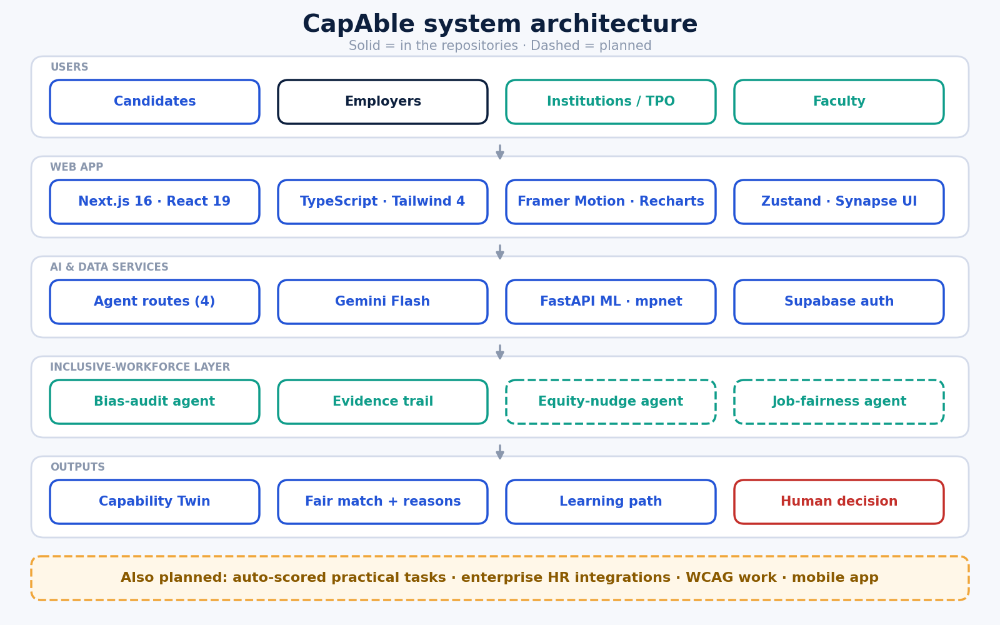</p>

Solid boxes exist in the repositories. Dashed boxes are planned.

| Layer | Technology | Source |
|---|---|---|
| Web app | Next.js 16.3.1, React 19, TypeScript, Tailwind CSS 4, Framer Motion, Recharts, Zustand, lucide-react | `Access-Hire/package.json` |
| Server API routes | `translate-capability`, `learning-pathway`, `opportunity-match`, `bias-audit` | `Access-Hire/app/api/agents/` |
| ML inference | FastAPI, sentence-transformers, PyTorch 2.3.1 (CPU), scikit-learn, pandas | `accesshireml/requirements.txt`, `Dockerfile` |
| Generative agents | Google Gemini Flash | `Access-Hire/lib/gemini.ts` |
| Authentication | Supabase | `Access-Hire/.env.example` |
| Accessibility | Synapse context (OpenDyslexic, high contrast) | `Access-Hire/lib/synapse-context.tsx` |
| Deployment | Frontend on Vercel; ML service ships with a Dockerfile | live prototype, `accesshireml/Dockerfile` |

The deployed prototype also uses Firestore, a Vapi voice interview and Firebase email triggers; check its own code for those.

---

## 📏 Honest project status

We would rather be exact than impressive.

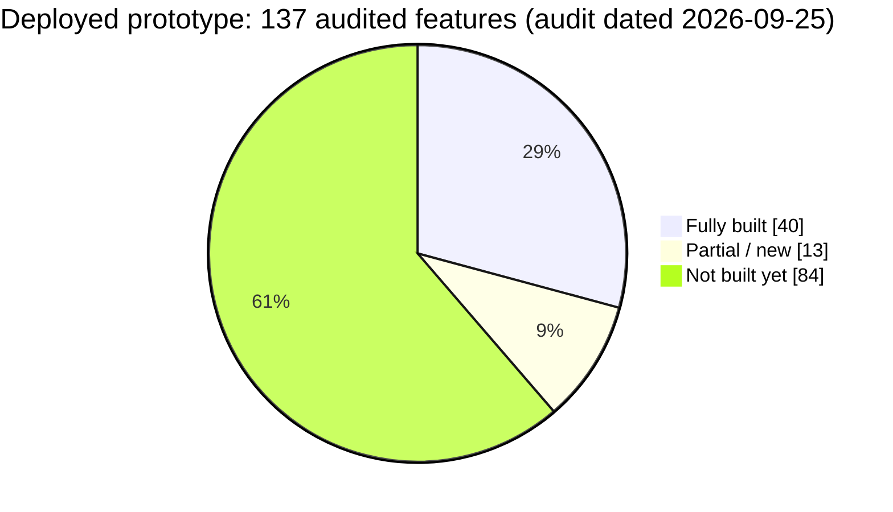

<p align="center">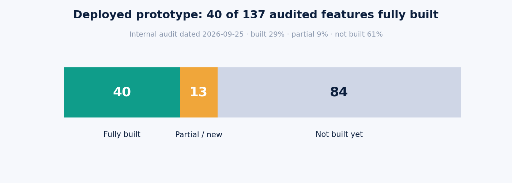</p>

| Area | Working today |
|---|---|
| Candidate career | AI career-path mapping, skill-gap analysis, personalised learning paths, QR-linked certificates, public profile, portfolio with GitHub sync, resume tailoring, ATS score |
| Interview prep | AI voice mock interview, session history and statistics, filler-word counter |
| Institution | Placement dashboard, bulk CSV invite, NAAC/NIRF report, faculty dashboard, skill-matrix export |
| Employer | Role posting, candidate pipeline, offer-letter generation, interview scheduling |
| Platform | Role-based security rules, in-app notifications, dark mode |

**Not built yet:** equity-nudge and job-fairness agents, automated bias-audit reports in the deployed app, auto-scored practical tasks, WCAG compliance, mobile app.

---

## ⚙️ Run it locally

**Frontend** — Node.js 20+ and npm. Code is in [`frontend/`](frontend/).

```bash
cd frontend
npm install
cp .env.example .env.local     # fill in your own values
npm run dev                    # http://localhost:3000
```

**ML service** — code is in [`ml-service/`](ml-service/).

```bash
cd ml-service
pip install -r requirements.txt        # or: docker build -t accesshire-ml .
uvicorn app.main:app --host 0.0.0.0 --port 8000
```

| Variable | Used for |
|---|---|
| `GOOGLE_GEMINI_API_KEY` | Server-side Gemini calls |
| `NEXT_PUBLIC_GEMINI_API_KEY` | Exposed to the browser. Avoid in production; use the server-side key |
| `NEXT_PUBLIC_SUPABASE_URL`, `NEXT_PUBLIC_SUPABASE_ANON_KEY` | Supabase authentication |
| `ACCESSHIRE_ML_API_URL` | URL of the running ML service |

Never commit real keys. Other scripts: `npm run build`, `npm run start`, `npm run lint`. The repository's `AGENTS.md` warns that Next.js 16 has breaking changes, so read `node_modules/next/dist/docs/` before framework-level changes.

---

## 🖼️ Gallery

These are illustrations, not screenshots. Add real screenshots in [`assets/screenshots/`](assets/screenshots/README.md).

<table>
  <tr>
    <td align="center">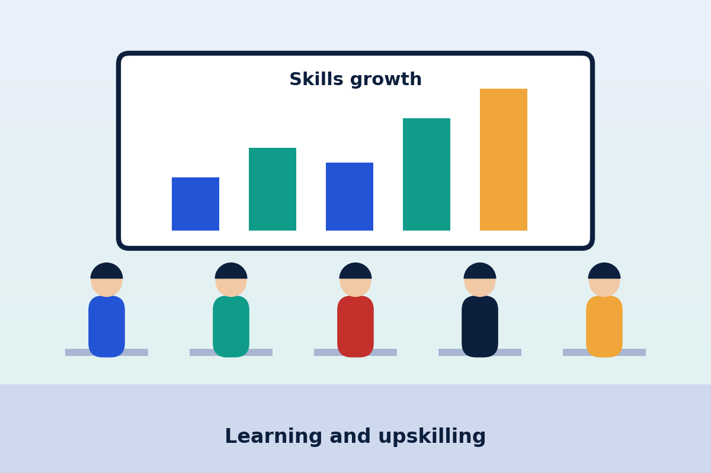<br><sub>Learning and upskilling</sub></td>
    <td align="center"><br><sub>Institutions and placements</sub></td>
  </tr>
  <tr>
    <td align="center"><br><sub>Verified capability</sub></td>
    <td align="center"><br><sub>Workforce insight</sub></td>
  </tr>
</table>

---

## 🗺️ Roadmap

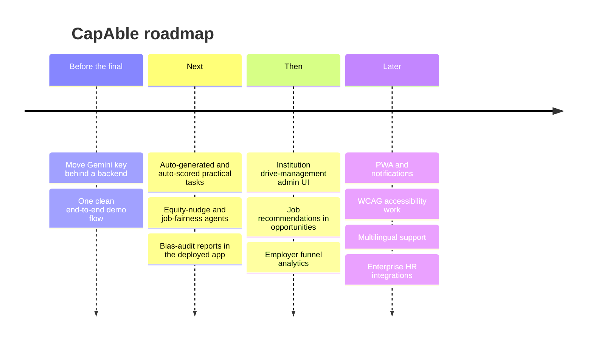

---

## ⚖️ Responsible AI & privacy

- 🧑‍⚖️ **AI recommends, a human decides.** Match and bias-audit outputs are for human review.
- 🔎 **Explainable by design.** Every capability carries evidence and an explanation, so any result can be questioned.
- 🚫 **No fabrication.** Resume generation is restricted to verified projects and capabilities.
- 🔐 **Role-based security rules** protect data in the deployed prototype.
- 📝 We make no compliance claims. Keep real personal data out of the demo and share datasets only with permission.

---

## 👥 Team ArcLight

<table align="center">
  <tr>
    <td align="center"><b>Deven</b></td>
    <td align="center"><b>Aditya Singh</b></td>
    <td align="center"><b>Rishabh Verma</b></td>
    <td align="center"><b>Divya Verma</b></td>
  </tr>
</table>

<p align="center"><b>Hackshift · IIIT Delhi</b></p>

## 📄 License

No license file has been added yet. Add one (for example MIT or Apache-2.0) before inviting outside contributions.

<p align="center">
  
</p>
